Social media is the most common use case for Nostr (and probably the reason you're reading this). Nostr is SO much [more](/tags/?tag=other) than just social media,
but that's where the bulk of the activity is, and is what I'm focusing on in ths post. Even though the protocol is still so young, that has not prevented an explosion of excellent 
[social media](/tags/?tag=social) focused clients that predominantly coalesce around the Twitter (X) style feed, containing shorter form content, often with images, and the ability to comment, 
like and share.

This first steps guide showcases one of the most polished and simplest examples of such a client, [Primal](https://primal.net). Primal is a cross platform app, that also works on your computer too. The steps that follow are demonstrated on iPhone, but should be identical for Android users. There may be some topics of concepts here that are new to you, to learn more about them, check out our [Nostr 101](/101) to learn more about Nostr basics and why it matters.

You can and should explore all of the other options available to you, that's the beauty of Nostr, you're free to choose how and where to interact with your social network. No lock in. No walled gardens. True freedom.

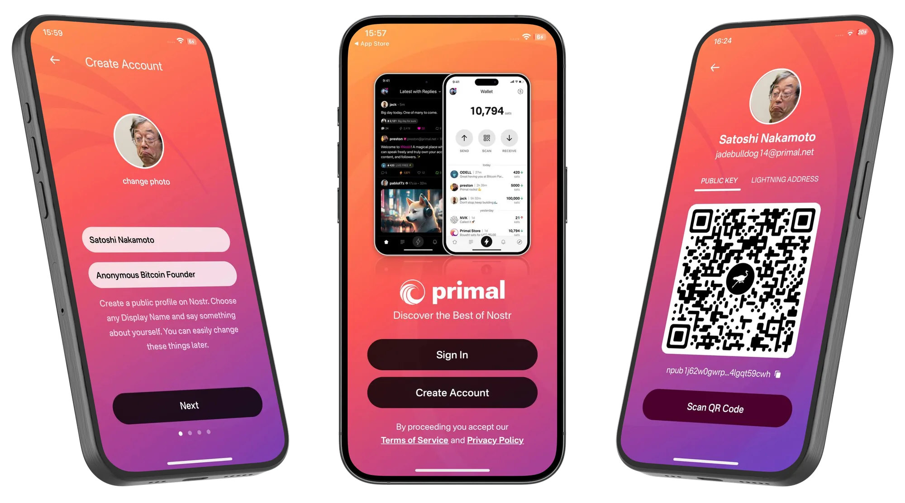
*Primal Mobile App*

# Getting Started

1. Go to your app store and download Primal to your phone.

  <a
    href="https://apps.apple.com/us/app/primal/id1673134518"
    target="_blank"
    rel="noopener noreferrer"
    class="hero__button button button--primary"
  >iOS ⬇️ </a>

  <a
    href="https://play.google.com/store/apps/details?id=net.primal.android"
    target="_blank"
    rel="noopener noreferrer"
    class="hero__button button button--primary"
  >Android ⬇️ </a>

 

{:start="2"}
2. Open Primal and choose Create Account. Choose your public display name and add a short bio about yourself.

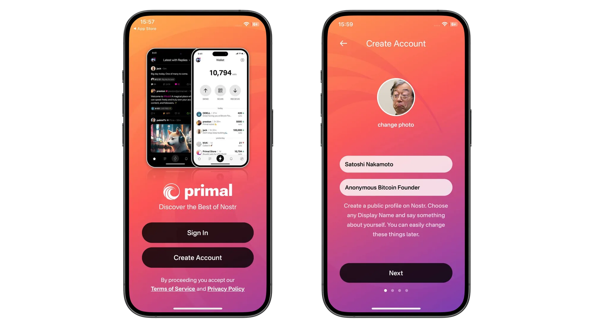
*Getting Started*

{:start="3"}
3. Select your chosen interests from the list provided. This will bootstrap your feed and auto-follow a number of accounts so that your feed is not completely empty when starting out.

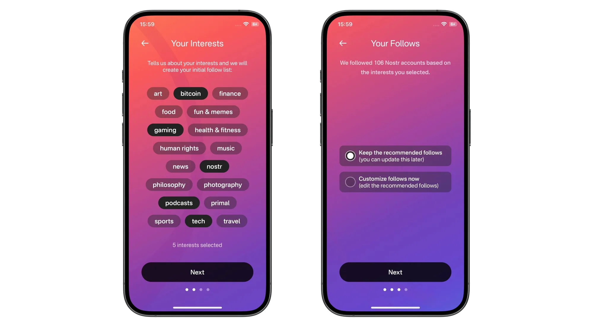
*Choosing your interests*

{:start="4"}
4. Review your account info and tap Create Account Now. Take note of the fact that 'Your Nostr Key is available in your Account Settings'. We'll revisit this shortly.

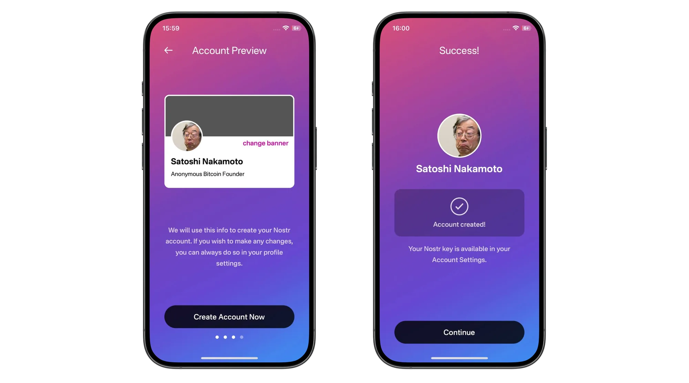
*Account Preview*

{: .note }
Primal replaced its original wallet in April 2026 with a new built-in wallet. The wallet screenshots below show the previous version, so your screens may look a little different. For more on wallets and zaps, see [Set Up Zaps Properly](/zaps).

{:start="5"}
5. Next is an optional step of activating the wallet feature within Primal. Having a wallet within your social client enables you to send and receive value (known as 'Zaps') in the form of Bitcoin. On Facebook and Twitter you can like a post, but it means much more to send someone fractions of a penny (or more if you like) to show your appreciation for their insights. You'll need to provide some personal information to enable the wallet, including an email address.

{: .caution }
Using the internal wallet and purchasing sats with your credit card will tie your Nostr identity to your real ID. Think **very** carefully before carrying out this step.   Learn more [here](#wallet-privacy).

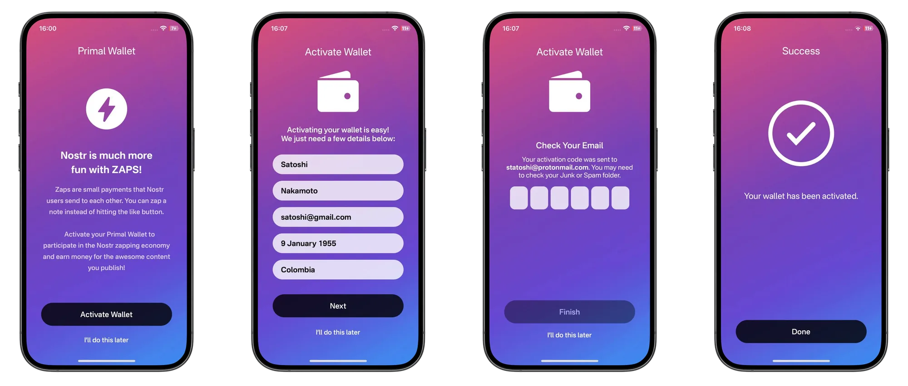
*Wallet Activation (optional)*

{:start="6"}
6. That's it, you're now set up and ready to start sharing your thoughts, feelings and memes with the world via a decentralized and censorship resistant social network. To post your first
note and say hello to the Nostr world, tap the + in the bottom right corner.

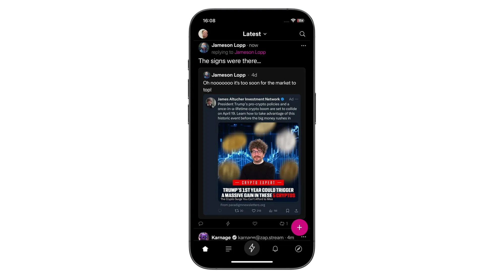
*Account Created*

{:start="7"}
7. If you activated the wallet at step 5, you might want to deposit some Bitcoin in there to allow you to send some value to your friends. There are three main ways to do this:
- Post some awesome content and have people send you value in the form of 'Zaps'
- Send some Bitcoin from a wallet you already have
- Purchase some directly within Primal

The latter is made very simple thanks to the in-app purchase feature, which allows you to purchase a small amount with the card you likely already have connected to your Apple/Google account. All you need to do is tap 'Buy Sats Now'. 

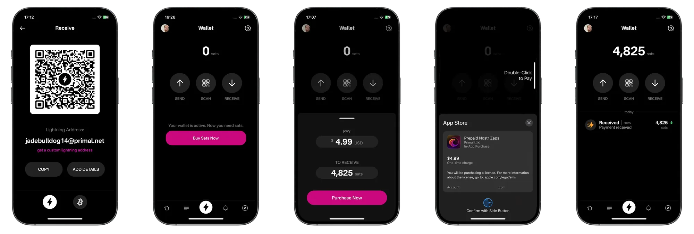
*Getting some sats*

{:start="8"}
8. Next, let's look at the different feeds available on our home screen. Tap 'Latest' at the top of the screen and you can toggle between three different types of home feeds, great for discovering new people and content.

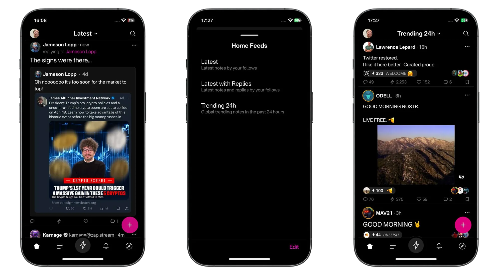
*Navigating your feeds*

{:start="9"}
9. Let's assume you already have some friends on Nostr and want to find and follow them. Tap the search icon in the top right corner, the enter the name of the person you want to follow. 
Once on their profile, simply tap the 'Follow' button.

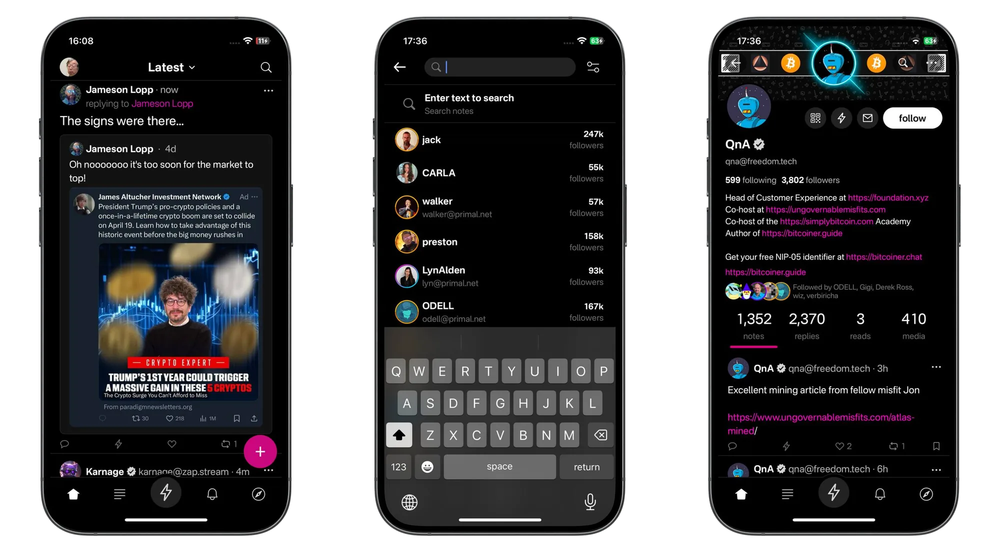
*Finding a profile*

{:start="10"}
10. So you found a friend and want to start interacting with them so they know you made it over to Nostr. Simply find a note you like and choose from the different types of interactions available. From left to right they are:
- **Comment**
- **Zap** (send value from your wallet to theirs)
- **Like**
- **Repost**
- **Bookmark**

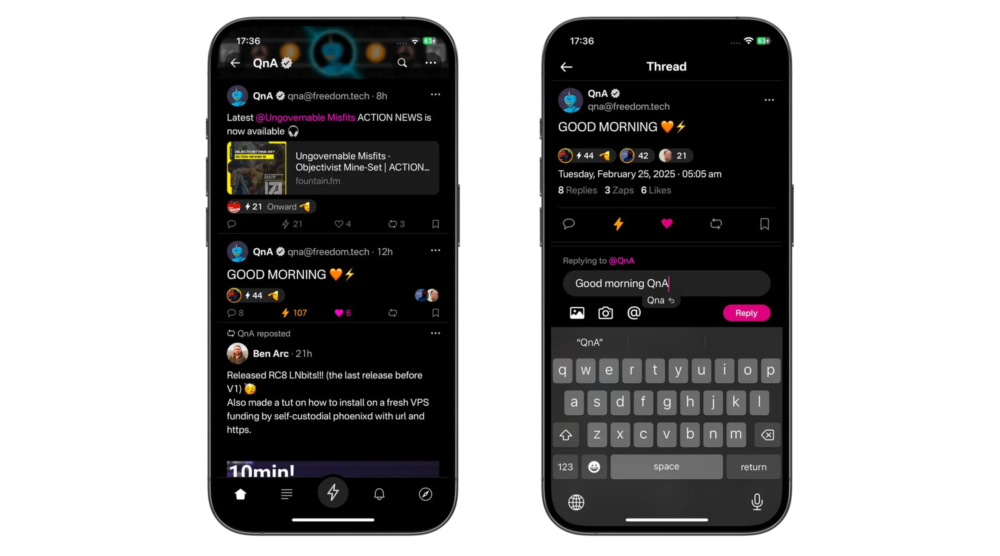
*Replying to a note*

When Zapping, a single tap will send a tiny amount of 42 sats. If you want to send more, or a custom amount, tap and hold the zap button to bring up a selector menu. All default zap amounts are configurable in the app settings page.

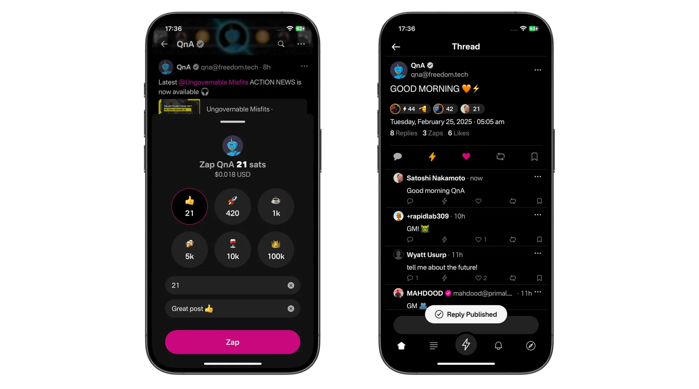
*Zapping a note*

{:start="11"}
11. After you've started posting and interacting with others, you'll likely receive some notifications to tell you. Notifications can be filtered into interaction types.

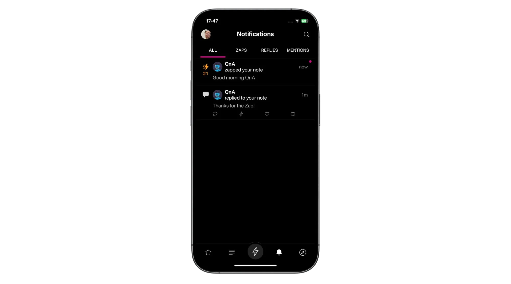
*Notifications*

{:start="12"}
12. Another great way to find more people to follow and interact with is to use the discover page. To open it, tap the compass in the bottom right corner of the screen. Here you'll 
be able to browse different types of pre-built feeds, trending profiles, notes with large zaps and extra topics.

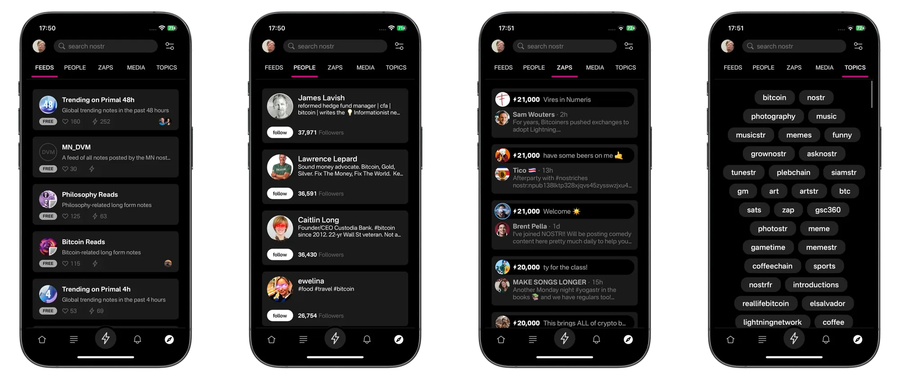
*Finding more signal*

# The Important Part

You might have noticed that throughout that setup, you were not asked for a unique username, nor were you asked for a password. So how the hell is this secure? What happens if you log out? Is your account lost forever? 

Ths is where Nostr really starts to shine. Just like in Bitcoin or other cryptocurrencies, your Nostr account is protected by a 'Private Key'. Anyone with knowledge of the 
private key can access your account **in any Nostr client**. No private key, no access. So let's make sure you have a backup copy of it, so you can still recover access to your account in the event you lose your phone!

Tap on your profile image in the top left of the screen. Then tap Settings > Keys. Here you'll see two keys, one public and one private.
Your public key is how people find you on Nostr. It is often referred to by its more technical name 'nPub' which is the prefix if the key itself. Your public key is designed to be exactly that, public!

Your private key is sometimes referred to by its technical name 'nSec' which is also the prefix of the key. Copy your private key and paste it somewhere safe and secure, in a location accessible independently from your phone, and only by you.

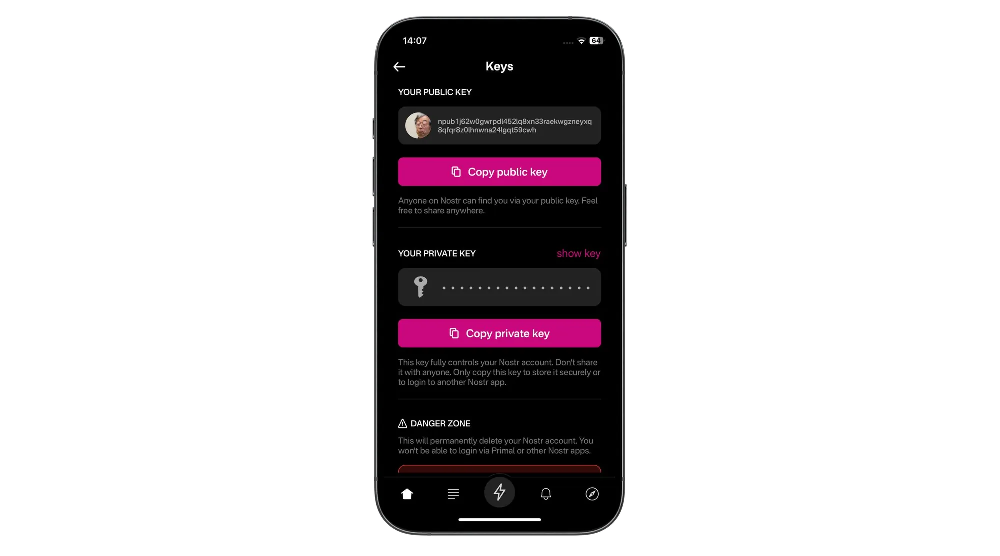
*Your Private Key*

If you were to lose your phone, or accidentally delete the Primal app, now all you'd need to do is head back to step 1 above and choose Sign In. You'd then be asked to paste your private key, after which your profile and content would be magically restored. 

{: .tip }
Your private key can be imported into any other Nostr social client for the same result.

# Some Things to Consider

This post has one primary focus - To get you from zero to posting and zapping in the quickest time and with the least friction. To acheive this, there are some trade-offs made that you should be aware of.

### The Built-In Wallet
Since April 2026, Primal's built-in wallet is one that Primal describes as self-custodial, replacing its earlier custodial wallet. Some in the community question how self-custodial it really is, so treat it like a spending wallet. Keep small amounts there, and if your balance ever gets to a level that makes you uncomfortable, send a good chunk of it to a Bitcoin wallet where you fully control the keys. I recommend [Phoenix](https://phoenix.acinq.co/) or [Zeus](https://zeusln.com/).

{: .caution }
Back up your Primal wallet in its settings as soon as you start using it

### Wallet Privacy

If you choose to top up the wallet using the convenient in-app purchase method, you will tie that small amount of Bitcoin ownership to your Nostr account. If you Nostr account is literally your name, you might not have an issue with this, but often times people like to remain pseudonymous online. If you fall into that category, using your credit card to deposit Bitcoin into your Nostr account is not a good idea.

You can also connect an external Lightning wallet using Nostr Wallet Connect (NWC). Our [Set Up Zaps Properly](/zaps) guide covers how. 

> Your private key allows you to take your profile and social network to any other client
>
> <cite>– QnA</cite>
