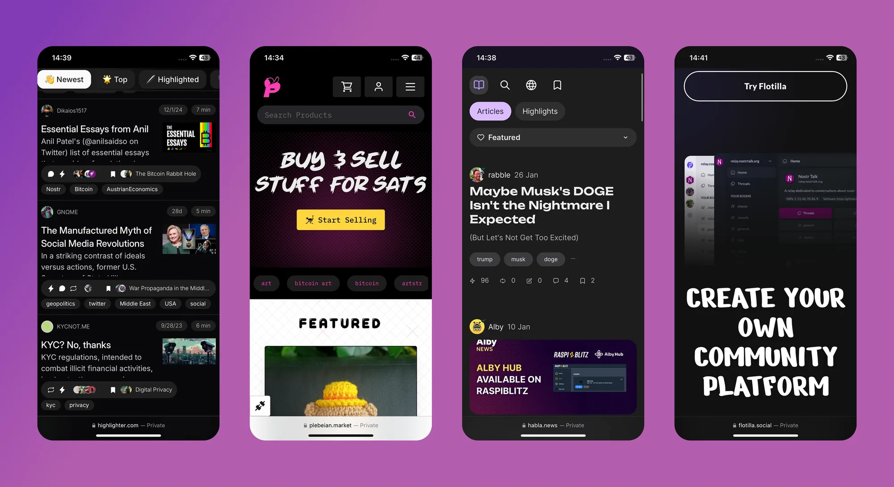
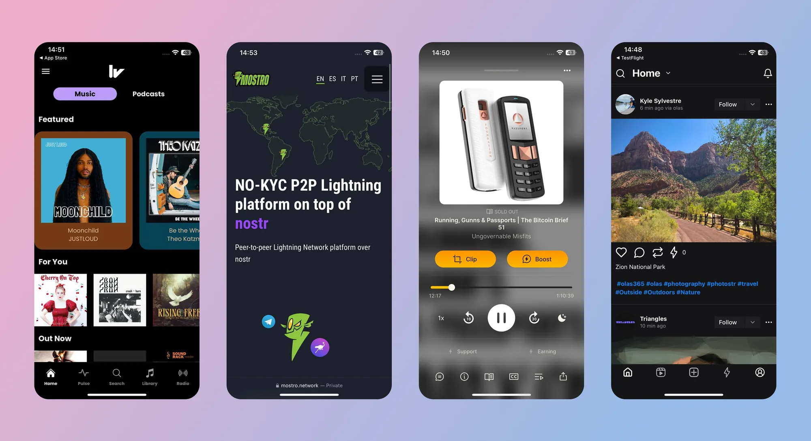
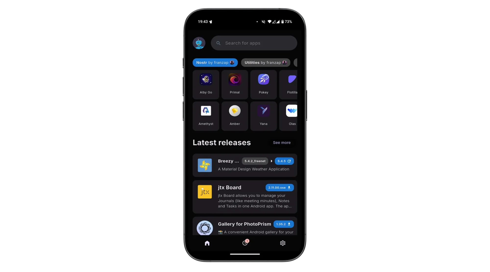

When most people stumble across Nostr, they see is as a 'decentralized social media alternative' — something akin to Twitter (X), but free from corporate control. But the full name, "Notes and Other Stuff Transmitted by Relays", gives a clue that there’s more to it than just posting short messages. The 'notes' part is easy to grasp because it forms almost everyone's first touch point with the protocol. But the 'other stuff'? That’s where Nostr really gets exciting. The 'other stuff' is all the creative and experimental things people are building on Nostr, beyond simple text based notes. 

Every action on Nostr is an event, a like, a post, a profile update, or even a payment. The 'Kind' is what specifies the purpose of each event. Kinds are the building blocks of how information is categorized and processed on the network, and the most popular become part of higher lever specification guidelines known as [Nostr Implementation Possibility - NIP](https://nostr-nips.com/). A NIP is a document that defines how something in Nostr should work, including the rules, standards, or features. NIPs define the type of 'other stuff' that be published and displayed by different styles of client to meet different purposes.

> Nostr isn’t locked into a single purpose. It’s a foundation for whatever 'other stuff' you can dream up.
>
> <cite>– QnA</cite>

# Types of Other Stuff

The 'other stuff' name is intentionally vague. Why? Because the possibilities of what can fall under this category are quite literally limitless. In the short time since Nostr's inception, the number of sub-categories that have been built on top of the Nostr's open protocol is mind bending. Here are a few examples:

1. Long-Form Content: Think blog posts or articles. [NIP-23](https://nostr-nips.com/nip-23).
2. Private Messaging: Encrypted chats between users. [NIP-04](https://nostr-nips.com/nip-04).
3. Communities: Group chats or forums like Reddit. [NIP-72](https://nostr-nips.com/nip-72)
4. Marketplaces: People listing stuff for sale, payable with zaps. [NIP-15](https://nostr-nips.com/nip-15)
5. Zaps: Value transfer over the Lightning Network. [NIP57](https://nostr-nips.com/nip-57)

  

    
    
    
    
  

# Popular 'Other Stuff' Clients

Here's a short list of some of the most recent and popular apps and clients that branch outside of the traditional micro-blogging use case and leverage the openness, and interoperability that Nostr can provide. 

### Blogging (Long Form Content)

- [Habla](https://habla.news/) - *Web app for Nostr based blogs*
- [Highlighter](https://highlighter.com/) - *Web app that enables users to highlight, store and share content*

### Group Chats

- [Flotilla](https://flotilla.social/) - *Relay-based (NIP-29) group chat and community client*
- [0xchat](https://github.com/0xchat-app) - *Mobile based secure chat*
- [Flotilla](https://flotilla.social/) - *Web based chat app built for self-hosted communities*
- [Nostr Nests](https://nostrnests.com/) - *Web app for audio chats*
- [White Noise](https://github.com/erskingardner/whitenoise) - *Mobile based secure chat*

*Highligher, Plebeian Market, Habla + Flotilla*

### Marketplaces

- [Shopstr](https://shopstr.market/) - *Permissionless marketplace for web*
- [Plebeian Market](https://plebeian.market/) - *Permissionless marketplace for web*
- [LNBits Market](https://github.com/lnbits/nostrmarket#nostr-market-nip-15---lnbits-extension) - *Permissionless marketplace for your node*
- [Mostro](https://github.com/MostroP2P/mostro) - *Nostr based Bitcoin P2P Marketplace*

### Photo/Video
- [Olas](https://github.com/pablof7z/snapstr/releases) - *An Intragram like client*
- [Freeflow](https://github.com/nostrlabs-io/freeflow) - *A TikTok like client*

### Music

- [Fountain](https://fountain.fm/) - *Podcast app with Nostr features*
- [Wavlake](https://wavlake.com/) - *A music app supporting the value-for-value ecosystem*

*Wavlake, Mostro, Fountain + Olas*

### Livestreaming

- [Zap.stream](https://zap.stream/) - *Nostr native live streams*

### Misc

- [Wikifreedia](https://wikifreedia.xyz/) - *Nostr based Wikipedia alternative*
- [Wikifreedia](https://wikifreedia.xyz/) - *Nostr based Wikipedia alternative*
- [Pollerama](https://pollerama.fun/) - *Nostr based polls*
- [Zap Store](https://zapstore.dev) - *The app store powered by your social graph*

*Zap Store*

The 'other stuff' in Nostr is what makes it special. It’s not just about replacing Twitter or Facebook, it’s about building a decentralized ecosystem where anything from private chats to marketplaces can thrive. 
The beauty of Nostr is that it’s a flexible foundation. Developers can dream up new ideas and build them into clients, and the relays just keep humming along, passing the data around. 
It’s still early days, so expect the 'other stuff' to grow wilder and weirder over time!

You can explore the evergrowing 'other stuff' ecosystem at [NostrApps.com](https://nostrapps.com/), [Nostr.net](https://nostr.net/) and [Awesome Nostr](https://github.com/aljazceru/awesome-nostr).
