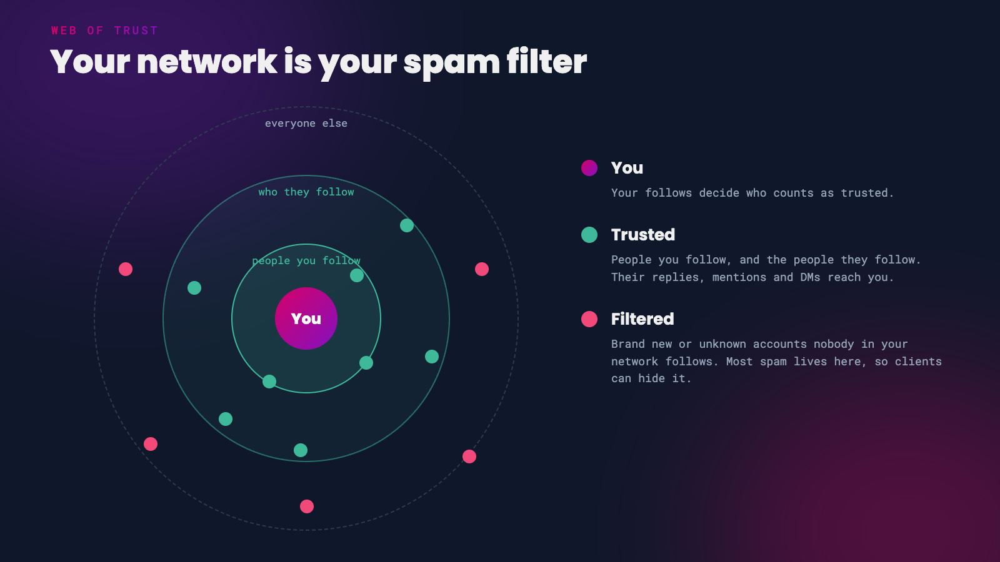

Nostr has no algorithm deciding what you see. Your feed is built from the people you follow, which means a brand new account starts with an empty timeline. And because anyone can create an account in seconds, spam is a fact of life on an open network.

Both problems have the same fix: build a good network. This guide shows you how to find interesting people quickly, and how to use your network to filter out the noise.

# Finding People

## Start With a Follow Pack

A follow pack, also called a starter pack, is a list of accounts someone has put together around a theme, such as Bitcoin developers, photographers or your local meetup. Following a few good packs is the fastest way to fill an empty feed.

- **[following.space](https://following.space/)** lets you browse and share follow packs from across Nostr.
- **Primal**, **Damus** and **Amethyst** all show follow packs in their apps, in Explore, during sign-up or in feed views.
- **[nstart.me](https://nstart.me/)** is a friendly sign-up wizard that creates your account, helps you back up your key and starts you off following some long-standing Nostr users. You can also send friends an nstart link with your own suggested follows added.

{: .tip }
Don't follow a whole pack in one go. Pick a handful of people whose posts you enjoy, then check who *they* follow and interact with. Your feed will be much better for it.

## Explore Feeds and Topics

Most clients have an Explore or Discover area for trending posts, topics and people. Many also support **custom feeds**, built by other people or services, for things like trending notes, photography or long-form articles. In Primal, browse the **Feed Marketplace**. Amethyst and other clients have their own custom feed options.

Hashtags work much like everywhere else. Search for a topic you care about, find who's posting good things about it, and follow them.

## Bring Your Friends Along

- **From Mastodon and the fediverse**: [Mostr](https://mostr.pub/) bridges the two networks, so you can follow fediverse accounts from Nostr and they can follow you.
- **From X or anywhere else**: share your npub or [NIP-05 address](/nip05) in your other profiles, and post about the move. Most people find you because you told them where to look.

[Nostr Compass](https://nostrcompass.org/) is a good weekly newsletter for keeping up with new apps, features and ideas, and a good way to find active builders to follow.

 

# Keeping the Spam Out

*Let your network do the filtering*

## Use Your Web of Trust

The most effective spam filter on Nostr is your own network. A **web of trust** treats the people you follow, and the people they follow, as trusted. Accounts that nobody in your network follows, which is where nearly all spam comes from, can be hidden or pushed to the bottom.

*How web of trust filtering works*

Look for these settings in your client:

- **Damus** - **Trusted Network** settings, plus a filter for hashtag spam and an option to hide 'hellthreads' with huge numbers of tagged people.
- **Amethyst** - turn on web of trust from the card on your Home screen.
- **Jumble** - **Hide untrusted notes** and **Hide content from untrusted users**.
- **Coracle** - a **web of trust threshold** setting.
- **YakiHonne** - a trust score for every account, with a minimum score for what you see.
- **Primal** - **Content Moderation** settings, where you can subscribe to Primal's spam filter.

{: .note }
Web of trust filtering is only as good as your follows. A few thoughtful follows make a better filter than hundreds of random ones.

## Mute Freely

Your mute list lives on Nostr, so it follows you to every app that supports it. You can mute people, words, hashtags and whole threads. Some apps, like Coracle, mute privately by default so nobody else can see who you've muted.

## Use Relays That Filter

You can also filter spam at the relay level:

- **Web of trust relays**, such as [wot-relay](https://github.com/bitvora/wot-relay), only store notes from people in your network. Some are public and you can [run your own](/run-your-own-relay).
- **Paid relays** like [nostr.wine](https://nostr.wine/) and [nostr.land](https://nostr.land/) keep out most spam by charging to write. nostr.wine's [filter relay](https://docs.nostr.wine/filter/readme) narrows the global feed to your follows and their follows.

## Report Real Spam

Most apps let you report a note or account (NIP-56) as spam, impersonation or worse. A report doesn't remove anything from Nostr, since there's no central moderator, but some apps use reports from people you follow to warn you or hide content. Report genuine abuse and mute everything else.

## Keep Your DMs Clean

Spam DMs are less of a problem when you use [private DMs](/private-messages) and DM relays that require login. Damus also keeps messages from people you don't follow in a separate **Message Requests** area, so strangers can't fill your inbox, and other apps have similar options.

 

# Your First Week

1. Sign up, or tidy your profile, and add a [NIP-05 address](/nip05) so people can find you.
2. Follow a few people from two or three follow packs that match your interests.
3. Add one or two custom feeds and explore the hashtags you care about.
4. Reply to people. Conversations are how you get noticed and find more people worth following.
5. Turn on web of trust filtering and mute anything you don't want to see.

---

If you found this post useful, please share it with your peers and consider following and zapping me on Nostr. If you write to me and let me know
that you found me via this post, I'll be sure to Zap you back! ⚡️

  <button
    id="nostr-zap-target"
    class="hero__button button button--primary nostr-zap-button nostr-zap-button--primary"
    data-npub="npub15c88nc8d44gsp4658dnfu5fahswzzu8gaxm5lkuwjud068swdqfspxssvx"
    data-relays="wss://relay.damus.io,wss://relay.snort.social,wss://nostr.wine,wss://relay.nostr.band"
  >
    Zap Me ⚡️
  </button>

  <a
    href="https://primal.net/p/npub15c88nc8d44gsp4658dnfu5fahswzzu8gaxm5lkuwjud068swdqfspxssvx"
    target="_blank"
    rel="noopener noreferrer"
    class="hero__button button button--primary"
  >Follow Me ✅</a>

