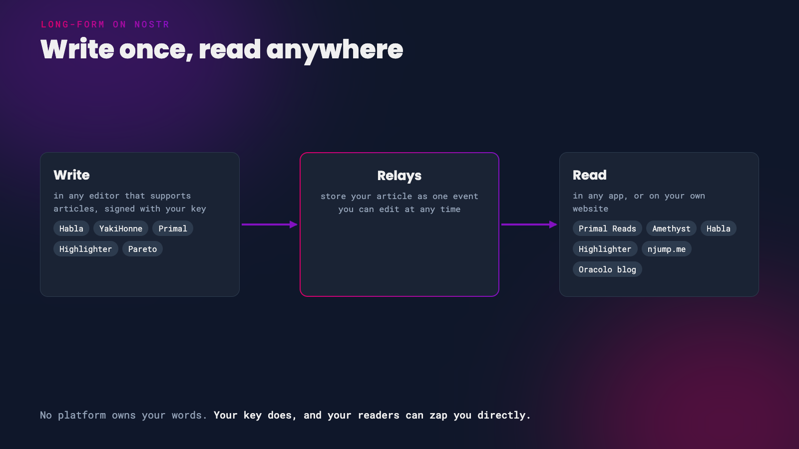

Nostr isn't only short notes. You can also publish full articles, with headings, images and links, the kind of thing you'd normally put on a blog or newsletter platform. On Nostr, though, the article belongs to your key, not to a platform. It can be read in many different apps, it can't be taken down by a single company, and your readers can zap you directly for it.

This guide covers how Nostr articles work, which apps to write them in, and how to turn them into a blog of your own.

*One article, many places to read it*

# How Nostr Articles Work

A Nostr article ([NIP-23](https://github.com/nostr-protocol/nips/blob/master/23.md)) is a special kind of event, separate from normal notes. Each one has:

- **the article itself**, written in Markdown, so headings, bold text, links, lists and images all work
- **a title, summary, cover image and hashtags**, which apps use for previews and discovery
- **a hidden identifier**, which means you can **edit** an article after publishing. Each edit replaces the old version, so readers always see the latest one.

Every article also gets its own link, starting `naddr1...`, that points to it in any Nostr app.

{: .note }
Not every Nostr app shows articles, so share yours with a link and readers can open it in an app that supports long-form.

 

# Pick an Editor

These apps can write and publish Nostr articles today:

| App | What it's good for |
|-----|--------------------|
| [Habla](https://habla.news/) | A simple, free blogging editor |
| [Primal](https://primal.net/reads) | Writing where many readers already are, with private drafts |
| [YakiHonne](https://yakihonne.com/) | A full editor, including importing from PDF |
| [Highlighter](https://highlighter.com/) | Writers and readers who like to highlight and discuss |
| [Pareto](https://pareto.space/en) | Journalism and newsletters, with private drafts |
| [Primal Studio](https://studio.primal.net/) | Paid plans for professionals moving from Substack, WordPress, Medium or Ghost, with scheduling and team review |

{: .caution }
Drafts work differently in every app. YakiHonne's **Save draft** publishes your draft to relays where anyone can read it, and Habla only keeps drafts in your current browser. Primal and Pareto keep drafts private and encrypted to your key.

 

# Write Your First Article

*Start with a story you'd tell a friend*

1. **Log in safely.** Use a browser extension or a remote signer like Amber or Clave, not your nsec. See [Secure your Nsec on iPhone and Desktop](/nsec-iphone-desktop).
2. **Write.** Most editors look like a normal word processor and save your work as Markdown behind the scenes.
3. **Add a title, summary and cover image.** The summary and image are what people see in previews, so they matter more than you'd think.
4. **Add a few hashtags** so people can find your article by topic.
5. **Publish**, then copy the article's link.
6. **Share it** in a short note so your followers see it in their feeds.

Images in Nostr articles are usually stored on **Blossom** servers. Your editor uploads them for you. Blossom files are identified by their contents, so if one server disappears, apps can find the same image on another server you use.

 

# Share It and Turn It Into a Blog

People without a Nostr app can still read your article:

- **[njump.me](https://njump.me/)** turns any article into a normal web page. Add your article's `naddr1...` code to the end of the address, as in `https://njump.me/naddr1...`, and share that link anywhere. It also shows a proper preview when shared on X or Telegram.
- **[Oracolo](https://oracolo.me/)** turns your Nostr articles into a blog. It's a single web page that updates itself whenever you publish a new article in Habla, YakiHonne or Highlighter. Download it and host it yourself, or point your own domain at Oracolo's free hosting.

 

# Get Read and Get Zapped

**Readers can zap articles** just like notes, so every article is a chance to be paid directly for your writing, with no platform taking a cut. Make sure your [zaps are set up properly](/zaps) before you publish.

**Readers can highlight your words.** In apps like Highlighter and Habla, readers can highlight a passage and comment on it, and those highlights are shared on Nostr too. It's a great way to see which parts of your writing land.

# Tips

- **Edit freely.** Spotted a typo after publishing? Edit and republish. The new version replaces the old one.
- **Don't use HTML.** Articles are Markdown only, and apps won't show HTML.
- **Back it up.** Publish to [your own relay](/run-your-own-relay) as well as public ones, so you always have a copy of your work.
