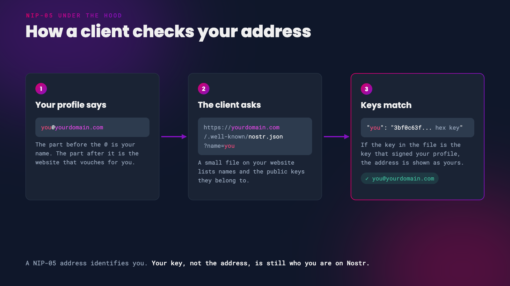

Your npub is your Nostr identity, but nobody is going to remember `npub15c88nc8d44gsp4658dnfu5fahswzzu8gaxm5lkuwjud068swdqfspxssvx`. A NIP-05 address gives that key a name that looks like an email address, such as `alice@example.com`. Clients show it on your profile, people can search for you by it, and it tells your followers that the person behind the key also controls a website they recognise.

Our [Nostr 101](/101) covers what NIP-05 is. This guide shows you how to set one up, either on a domain you own or through a free provider.


*A name people can find you by*

# How It Works


*How a client checks a NIP-05 address*

When a client sees `you@yourdomain.com` on a profile, it requests a small file from `https://yourdomain.com/.well-known/nostr.json?name=you`. If the file lists `you` with the same public key that signed your profile, the client shows the address. If it doesn't match, the address is ignored.

{: .note }
NIP-05 identifies you. It doesn't prove anything beyond 'whoever runs this domain says this key is called you'. Your key is still your identity, and if you ever change the address, your followers stay with your key.

<br/>

# No Domain? Use a Free Provider

If you don't own a domain, a provider can give you a name on theirs in a couple of minutes. These were all working at the time of writing:

- **[bitcoiner.chat](https://bitcoiner.chat/)** - free, with an optional donation.
- **[zaps.lol](https://zaps.lol/)** - free.
- **[Snort](https://snort.social/free-nostr-address)** - free names on snort.social.
- **[NostrPlebs](https://nostrplebs.com/)** - paid, from 12,500 sats, with a choice of domains.
- **[Primal Premium](https://primal.net/)** - includes a primal.net address as part of the subscription.

Each provider has its own sign-up steps. Once you have your address, skip to [Add It to Your Profile](#add-it-to-your-profile).

<br/>

# Set Up NIP-05 on Your Own Domain

## Step 1: Get Your Public Key in Hex

The file needs your public key in 'hex' format, not your npub. Both are the same key written differently. To convert it, paste your npub into the [nostrcheck.me converter](https://nostrcheck.me/converter/) or the [Damus key converter](https://damus.io/key/), or run this in a terminal if you have [nak](https://github.com/fiatjaf/nak) installed:

```
nak decode npub1...
```

You'll get a 64-character string of numbers and the letters a to f. That's your hex public key.

{: .caution }
Only ever paste your **npub** into a converter. Never your nsec.

<br/>

## Step 2: Create nostr.json

Create a file called `nostr.json` containing your chosen name and your hex key. Names can only use lowercase letters, numbers, hyphens, underscores and full stops.

```json
{
  "names": {
    "you": "your-64-character-hex-public-key"
  },
  "relays": {
    "your-64-character-hex-public-key": ["wss://relay.damus.io", "wss://nos.lol"]
  }
}
```

The `relays` section is optional but recommended. It tells clients where to find your notes.

You can list as many names as you like, for friends or family, by adding more lines under `names`. Use the name `_` and clients may show your address as just `yourdomain.com`.

## Step 3: Put It on Your Website

The file has to be available at `https://yourdomain.com/.well-known/nostr.json`, served:

- with the header `Access-Control-Allow-Origin: *`, or web clients won't be able to read it
- as JSON, not as a web page or a download
- **without any redirects**, including from `yourdomain.com` to `www.yourdomain.com`

How you do that depends on where your site is hosted.

**GitHub Pages** already sends the right header. Put the file in a `.well-known` folder in your repository. If your site is built with Jekyll, it ignores folders that start with a full stop, so add this to `_config.yml`:

```yaml
include: [".well-known"]
```

GitHub Pages redirects between `www` and the bare domain, so use whichever version of your domain loads without a redirect.

**Netlify** and **Cloudflare Pages** need the header added. Create a file called `_headers` in your published folder:

```
/.well-known/nostr.json
  Access-Control-Allow-Origin: *
```

**Vercel**: add this to `vercel.json`:

```json
{
  "headers": [
    {
      "source": "/.well-known/nostr.json",
      "headers": [{ "key": "Access-Control-Allow-Origin", "value": "*" }]
    }
  ]
}
```

**Your own nginx server**: add this inside your site's `server` block:

```nginx
location = /.well-known/nostr.json {
    types { } default_type application/json;
    add_header Access-Control-Allow-Origin * always;
}
```

<br/>

## Step 4: Check It Works

Open `https://yourdomain.com/.well-known/nostr.json` in your browser. You should see your file. Then check the header from a terminal:

```
curl -sI "https://yourdomain.com/.well-known/nostr.json?name=you" | grep -i access-control
```

You should see `access-control-allow-origin: *`.

<br/>

# Add It to Your Profile

1. Open **Edit Profile** in your client.
2. Enter your address in the NIP-05 field. Damus and Amethyst call it **Nostr Address**, and Primal's web app calls it **Verified Nostr Address (NIP-05)**.
3. Save your profile.

Your client should show the address on your profile within a few moments. To double-check from outside your client, visit `https://njump.me/you@yourdomain.com`, which should open your profile.

<br/>

# Troubleshooting

**The address doesn't show on my profile.** Check the key in `nostr.json` is your **hex** key, in lowercase, and not your npub.

**It works in some apps but not web clients.** The `Access-Control-Allow-Origin: *` header is missing. Netlify and nginx don't add it unless you tell them to.

**It worked, then stopped.** Look for a redirect. Moving your site to `www`, forcing a different domain, or switching hosts can add one, and clients won't follow it.

**My name has capital letters.** Names must be lowercase. `Alice@yourdomain.com` won't work, but `alice@yourdomain.com` will.

**I get a 404 on GitHub Pages.** Jekyll dropped the `.well-known` folder. Add the `include` line from Step 3.

---

If you found this post useful, please share it with your peers and consider following and zapping me on Nostr. If you write to me and let me know
that you found me via this post, I'll be sure to Zap you back! ⚡️

<div class="button-container">
  <button
    id="nostr-zap-target"
    class="hero__button button button--primary nostr-zap-button nostr-zap-button--primary"
    data-npub="npub15c88nc8d44gsp4658dnfu5fahswzzu8gaxm5lkuwjud068swdqfspxssvx"
    data-relays="wss://relay.damus.io,wss://nos.lol,wss://relay.primal.net,wss://nostr.wine"
  >
    Zap Me ⚡️
  </button>

  <a
    href="https://primal.net/p/npub15c88nc8d44gsp4658dnfu5fahswzzu8gaxm5lkuwjud068swdqfspxssvx"
    target="_blank"
    rel="noopener noreferrer"
    class="hero__button button button--primary"
  >Follow Me ✅</a>
</div>
