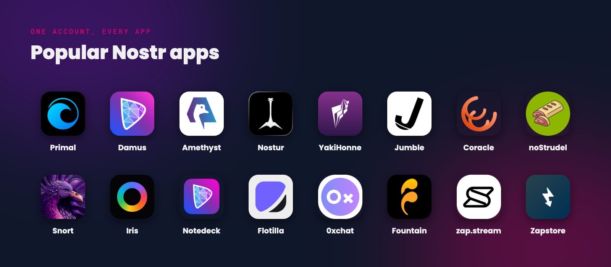
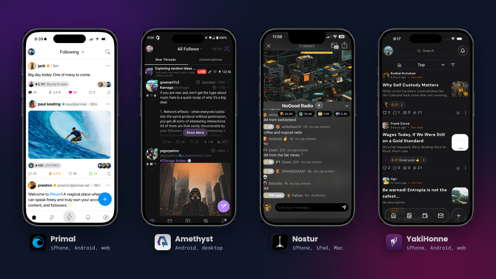
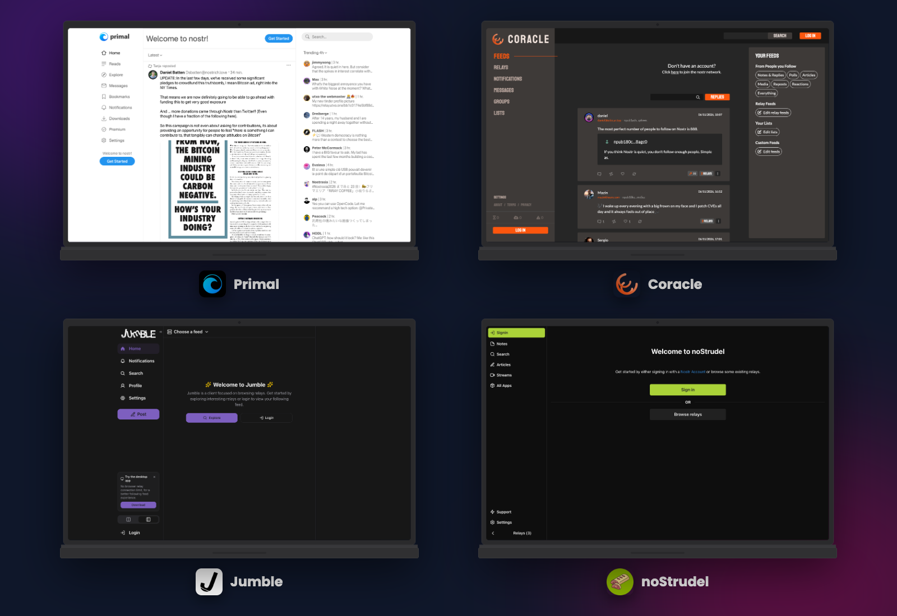
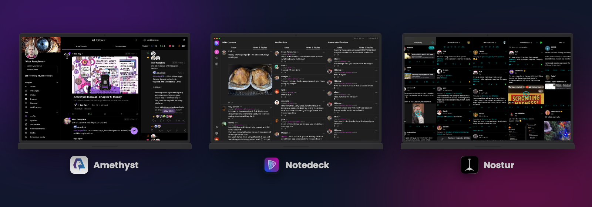
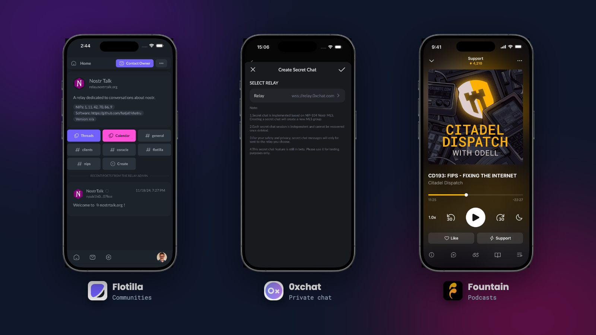

There's no single 'Nostr app'. Nostr is a protocol, and dozens of independent teams build apps on top of it. Because your account is just your key, **the same account works in all of them**. Your profile, follows and notes come with you, so you can try a few apps and keep the ones you like.

This guide covers the most popular Nostr apps at the time of writing, what each one is best at, and where to start.

*Some of the most popular Nostr apps*

{: .tip }
Trying lots of apps? Log in with a signer like [Amber](/amber) or [Clave](/nsec-iphone-desktop) instead of pasting your nsec into each one.

# Quick Picks

These are our suggestions, based on each app's features today.

| If you want... | Try |
|----------------|-----|
| The easiest start on iPhone or Android | **Primal** |
| A simple, focused iPhone app | **Damus** |
| Every feature going on Android | **Amethyst** |
| A powerful app for iPhone, iPad and Mac | **Nostur** |
| Nostr in your web browser | **Primal**, **Jumble** or **Coracle** |
| Group chats and communities | **Flotilla** or **0xchat** |
| Podcasts | **Fountain** |

 

# Social Apps for Your Phone

*Primal, Amethyst, Nostur and YakiHonne*

**[Primal](https://primal.net/)** (iPhone, Android, web) is the most polished place to start, and the one our [First Steps](/start) guide uses. It has a built-in Lightning wallet, so zaps work without any setup, plus long-form 'Reads', custom feeds and search. Primal is free, with optional Premium and Pro subscriptions.

**[Damus](https://damus.io/)** (iPhone) is one of the original Nostr apps, with a clean, simple design. It supports [private DMs](/private-messages), Nostr Wallet Connect for zaps and a long-form reader. An optional Damus Purple subscription adds extra features.

**[Amethyst](https://github.com/vitorpamplona/amethyst)** (Android, plus new desktop versions) supports a huge range of Nostr features, including private DMs, remote signers like Amber, a built-in Cashu wallet, picture and video feeds, and long-form articles. It's free and open source, and perfect for people who like to explore every setting.

**[Nostur](https://nostur.com/)** (iPhone, iPad and Mac) is a free, feature-rich Apple app with web of trust spam filtering, Nostr Wallet Connect, remote signer login, long-form reading and short video.

**[YakiHonne](https://yakihonne.com/)** (iPhone, Android, web) mixes social posts with articles, media and 'smart widgets', and supports remote signers and private DMs.

 

# Apps in Your Browser

No install needed. Open the site, log in with a browser extension or remote signer, and you're in.

*Primal, Coracle, Jumble and noStrudel in the browser*

 

- **[Primal](https://primal.net/)** - the same polished experience as the mobile apps.
- **[Jumble](https://jumble.social/)** - built around browsing relay feeds, with web of trust filtering. Also available as a desktop app and, newly, on Android.
- **[Coracle](https://coracle.social/)** - web of trust recommendations and moderation, private DMs and custom feeds.
- **[noStrudel](https://nostrudel.ninja/)** - a power user's app that shows you the raw workings of Nostr. Great for learning how it all fits together.
- **[Snort](https://snort.social/)** and **[Iris](https://iris.to/)** - two long-running web apps that are still being updated.

 

# On Your Computer

- **Amethyst** now has desktop versions for macOS, Windows and Linux.
- **[Notedeck](https://github.com/damus-io/notedeck)**, from the Damus team, is a column-based desktop app in the style of TweetDeck. It's still in beta.
- **Jumble** has a desktop app as well as its website.
- **Nostur** runs on Mac as well as iPhone and iPad.

*Amethyst, Notedeck and Nostur on the desktop*

 

# Chat and Communities

*Flotilla for communities, 0xchat for private chat and Fountain for podcasts*

- **[Flotilla](https://flotilla.social/)** (web, iPhone, Android) is a Discord-style app for group spaces, with chat, threads, calendars and articles, built on relays that host groups.
- **[0xchat](https://0xchat.com/)** (Android, macOS, Windows, Linux) is a dedicated private messenger with private DMs, groups and a Cashu wallet. Its iPhone app isn't currently available on the App Store.

 

# Podcasts and Live Streams

- **[Fountain](https://fountain.fm/)** (iPhone, Android) is a podcast app that uses your Nostr profile, lets you zap shows and episodes with Nostr Wallet Connect, and shows live streams.
- **[zap.stream](https://zap.stream/)** (web, Android) lets you watch and broadcast live streams and get zapped while you're live.

 

# Where to Get Android Apps

**[Zapstore](https://zapstore.dev/)** is an app store for Android built on Nostr. Apps are signed by their developers and published over Nostr, so you can install and update Nostr apps like Amethyst and Amber without relying on Google Play.

 

# Quiet or Retired Apps

Apps come and go quickly. These were popular once but aren't being updated, so we don't recommend starting with them:

- **Gossip**, a desktop app, is marked as idle by its developer.
- **Olas**, a photo app for iPhone, hasn't had an App Store update since March 2025.
- **Wavlake**, a music app, is currently offline.

{: .note }
This guide reflects each app as of November 2026. Nostr apps change fast, so check each app's own site for the latest features.

---

If you found this post useful, please share it with your peers and consider following and zapping me on Nostr. If you write to me and let me know
that you found me via this post, I'll be sure to Zap you back! ⚡️

  <button
    id="nostr-zap-target"
    class="hero__button button button--primary nostr-zap-button nostr-zap-button--primary"
    data-npub="npub15c88nc8d44gsp4658dnfu5fahswzzu8gaxm5lkuwjud068swdqfspxssvx"
    data-relays="wss://relay.damus.io,wss://nos.lol,wss://relay.primal.net,wss://nostr.wine"
  >
    Zap Me ⚡️
  </button>

  <a
    href="https://primal.net/p/npub15c88nc8d44gsp4658dnfu5fahswzzu8gaxm5lkuwjud068swdqfspxssvx"
    target="_blank"
    rel="noopener noreferrer"
    class="hero__button button button--primary"
  >Follow Me ✅</a>

