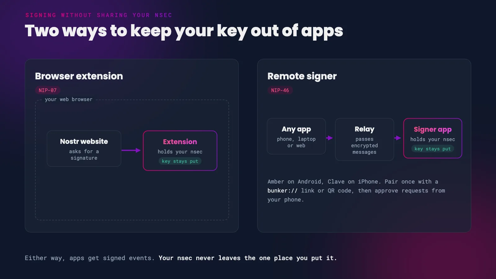
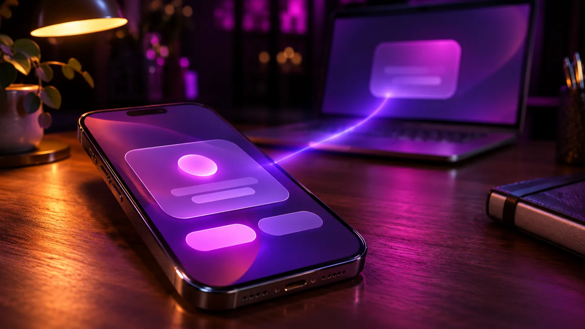

Your nsec is the key to your Nostr account. Whoever holds it can post as you and read your private messages, and you can't change it like a password. Our [Amber](/amber) guide showed Android users how to keep it in one dedicated app and let every other client ask that app for signatures. This guide does the same for iPhone users and for anyone using Nostr in a desktop browser.

The rule is the same everywhere: put your nsec in one trusted place, and never paste it into a new app just to try it out.

*Browser extensions and remote signers both keep your nsec in one place*

# Two Ways to Sign Without Sharing Your Nsec

**Browser extensions ([NIP-07](https://github.com/nostr-protocol/nips/blob/master/07.md)).** An extension in your web browser holds your nsec. When a Nostr website wants to post a note or like something on your behalf, it asks the extension to sign the event. The website never sees your key.

**Remote signers ([NIP-46](https://github.com/nostr-protocol/nips/blob/master/46.md)).** A signer app, usually on your phone, holds your nsec. Any client on any device connects to it once, using a `bunker://` link or a `nostrconnect://` QR code. From then on, the client sends signing requests to your signer over a relay, and the signer sends back signed events. Amber works this way, and so does Clave on iPhone.

{: .tip }
A remote signer on your phone can sign for a web client on your computer, even when the two are miles apart. The requests travel over Nostr itself.

 

# On iPhone: Clave

[Clave](https://github.com/dmnyc/clave) is a free and open source remote signer for iPhone. It keeps your nsec in the iPhone Keychain and signs for other apps in the background, using a notification to wake itself when a request comes in. You can set how much each connected app is trusted, see a log of everything it signed, and disconnect an app with one tap.

*Your iPhone as a signer*

1. Install **Clave - Nostr Signer** from the App Store. It's free and needs iOS 17.6 or later.

  <a
    href="https://apps.apple.com/us/app/clave-nostr-signer/id6762104155"
    target="_blank"
    rel="noopener noreferrer"
    class="hero__button button button--primary"
  >Get Clave ⬇️ </a>

 

{:start="2"}
2. Open Clave and allow notifications. Clave needs them to wake up and sign while it's in the background.

{:start="3"}
3. Create a new key, or import the nsec you already use. If you're importing, this should be the last time you ever paste it anywhere.

{:start="4"}
4. Tap **Connect** in Clave to get your `bunker://` link, or show it as a QR code.

{:start="5"}
5. In the client you want to use, choose its remote signer or 'bunker' login option and paste the link, or scan the QR code if the client is on another device.

{:start="6"}
6. Approve the connection in Clave. New connections start at a medium trust level, which you can change for each app in Clave at any time.

Clave's developer lists these clients as working with it: [Nostur](https://nostur.com/) on iPhone, and [Primal](https://primal.net/), [Coracle](https://coracle.social/), [Jumble](https://jumble.social/), [noStrudel](https://nostrudel.ninja/), [YakiHonne](https://yakihonne.com/) and [zap.cooking](https://zap.cooking/) on the web.

{: .note }
Using Clave and a client on the same iPhone? Paste Clave's `bunker://` link into the client. The QR code flow (`nostrconnect://`) is less reliable on a single iPhone, because iOS pauses the client while you switch to Clave.

Clave is still young. It has not had an independent security audit yet, and its connections all run through a single relay. Keep a backup of your nsec somewhere safe and offline, just as you would with any other signer.

## Other iPhone Options

- **[Nostash](https://apps.apple.com/app/nostash/id6744309333)** is a free Safari extension for iPhone, iPad and Mac. It works like the desktop extensions below, letting Nostr websites in Safari ask it for signatures. It needs iOS 18 or later, and at the time of writing it hasn't been updated since June 2025.
- **nsec.app** is a web-based remote signer. It struggles on iPhone because iOS doesn't keep web apps running in the background, so it often can't respond to requests. We no longer recommend it for iPhone users.

 

# On Desktop: Browser Extensions

On a Mac, Windows or Linux computer, the simplest option is a browser extension. Install one, put your nsec in it, and log in to Nostr websites with the extension.

- **[Alby](https://getalby.com/)** - a Lightning wallet extension for Chrome, Brave, Firefox and other browsers, which also signs Nostr events. A good choice if you already zap from your browser.
- **[nos2x](https://github.com/fiatjaf/nos2x)** - a small, signing-only extension for Chrome and Chromium-based browsers.
- **[nos2x-fox](https://addons.mozilla.org/en-US/firefox/addon/nos2x-fox/)** - the Firefox version of nos2x. It also works in Firefox on Android.

1. Install one of the extensions above from your browser's official extension store.
2. Open the extension and import your nsec, or create a new key.
3. On a Nostr website, choose the option to log in with a browser extension. The extension may ask you to allow the website to see your public key.
4. When you post, like or zap, the extension asks you to approve the signature. Most extensions let you remember your choice for a site, so you aren't asked every time.

{: .caution }
Only install extensions from your browser's official store or the developer's own site. A fake 'Nostr signer' extension is an easy way to steal keys.

 

## Or Use Your Phone as the Signer

If you'd rather your nsec never touches your computer at all, keep it on your phone and sign from there. Paste your signer's `bunker://` link into the website's remote signer login. Amber can also scan the QR code the website shows. Our [Amber guide](/amber#using-amber-with-a-web-client) walks through this with Coracle.

Some websites only support extension logins. On Firefox, [Bark](https://addons.mozilla.org/en-US/firefox/addon/bark-nostr/) bridges the gap: it acts as an extension for the website, but passes every signing request on to the remote signer on your phone.

 

# Which Should I Use?

| You use Nostr on | Keep your nsec in | Type |
|------------------|-------------------|------|
| Android | [Amber](/amber) | Remote signer |
| iPhone | Clave | Remote signer |
| Desktop browser | Alby, nos2x or nos2x-fox | Browser extension |
| Desktop browser, no key on your computer | Amber or Clave on your phone | Remote signer |

# Good Habits

- **One home for your nsec.** Keep it in a single signer and connect everything else to that signer.
- **Back it up offline.** Write it down, or save it as an `ncryptsec` ([NIP-49](https://github.com/nostr-protocol/nips/blob/master/49.md)), a copy of your key locked with a password. Store the backup somewhere other than your phone.
- **Review your connections.** Every so often, open your signer and disconnect apps you no longer use.
- **Try new apps safely.** Log in with your signer, never with your nsec. If an app only accepts a pasted nsec, try it with a throwaway account first.

> Private keys should be exposed to as few systems as possible as each system adds to the attack surface
>
> <cite>– NIP-46</cite>
