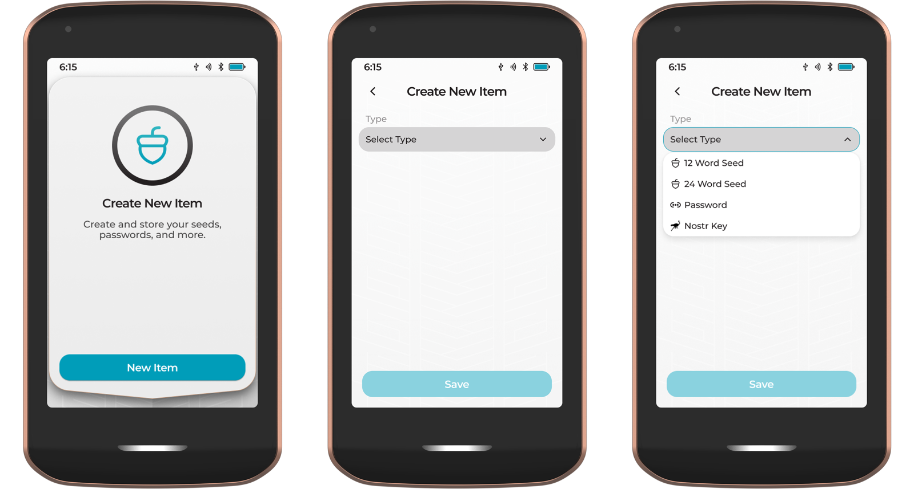
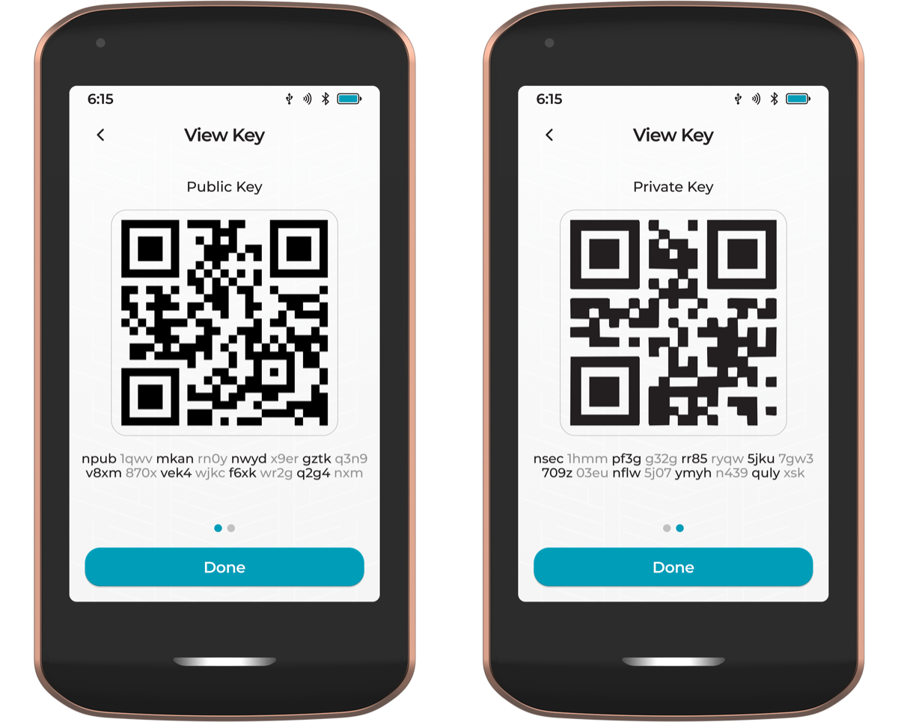
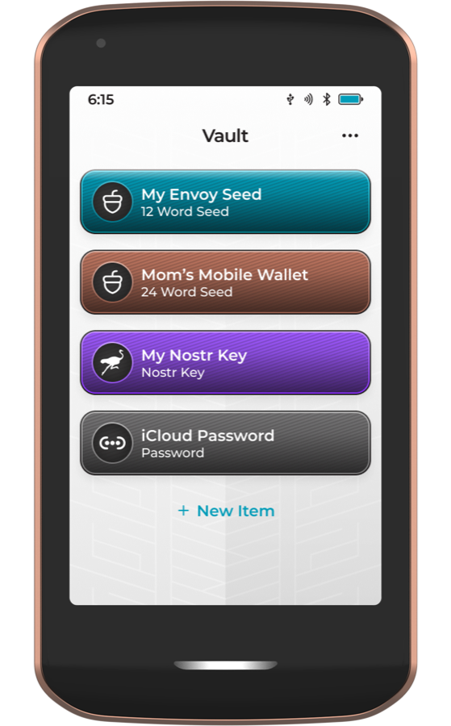

There's no 'forgot password' button on Nostr. Your nsec *is* your account, and there's no company that can reset it, lock it or hand it back to you. If someone else gets a copy of your nsec, they can do everything you can, for as long as they like.

That sounds scary, but a leaked key isn't the end of your Nostr life. This guide walks through what to do if it happens, and how to back up your key properly so it hopefully never does.

# What a Leaked Key Means

Anyone with your nsec can:

- **post, reply and react as you**
- **change your profile**, including your Lightning address, so zaps meant for you go to them
- **change who you follow**
- **read every private message** you've ever sent or received, including [private DMs](/private-messages)
- **send deletion requests** for your notes

There is no way to 'change' a key in the Nostr protocol today. Several proposals for key migration and revocation are being discussed, but none has been adopted yet. The only fix is to move to a new key, and bring your people with you.

{: .note }
Seeing posts or profile changes you didn't make? That usually means a leak, but not always. Some apps have been [caught showing forged events](https://eprint.iacr.org/2025/1459) without checking their signatures. Check your profile in two or three different apps before you act.

<br/>

# What to Do, Step by Step

Move quickly. Until you've moved, whoever has your key can keep making changes.

## 1. Save What You Can

Your profile and follow list can be overwritten, and relays only keep the latest version. Before anything else, copy your follow list. With [nak](https://github.com/fiatjaf/nak) installed, this saves it to a file:

```
nak req -k 3 -a your-hex-public-key -l 1 wss://relay.damus.io > follows.json
```

Also note down your profile details, Lightning address and NIP-05.

## 2. Create a New Key

Create your new key somewhere safe from day one: in a signer like [Amber](/amber) or Clave, or in your [Passport Prime Vault](#passport-prime-and-the-vault) if you have one. Back it up before you use it (see [Back Up Your Key](#back-up-your-key) below).

## 3. Announce the Move From Both Accounts

- From the **old** key, post a note saying the key is compromised and giving your new npub, and pin it if your app allows. Update the old profile's name and bio to say the same. The attacker may change it back, but many people will see it first.
- From the **new** key, post a note explaining the move and linking to the old account.
- Tell close contacts directly, through another channel if you can, so they know which account is really you.

## 4. Point Everything at Your New Key

- **NIP-05**: update your `nostr.json` (or your provider) to your new key. Anyone looking you up by name will find the new account. See our [NIP-05 guide](/nip05).
- **Lightning address**: add it to your new profile, and keep an eye on the old profile in case the attacker swaps in their own.
- **Wallet connections**: revoke every Nostr Wallet Connect connection in your wallet and set up new ones. NWC connections have their own secrets, separate from your nsec, but there's no reason to leave them in place. See [Set Up Zaps Properly](/zaps).
- **Signer sessions**: disconnect every app from your signer.

## 5. Rebuild Your Follows

Re-follow people from your new account, starting with the list you saved in step 1. Ask friends to follow your new npub and to share your announcement, since the people who follow you are the hardest part to move.

## 6. Assume Your Messages Are Exposed

Treat everything in your DMs as readable by someone else. If anything sensitive was in there, such as passwords, addresses or wallet details, change it now. Stop using the old key completely, even for reading.

<br/>

# Back Up Your Key

A good backup lets you keep your nsec off the internet and in as few places as possible, and means a broken or stolen phone doesn't cost you your account.


*Keep your backup offline and in more than one place*

**Use an encrypted backup.** An `ncryptsec` ([NIP-49](https://github.com/nostr-protocol/nips/blob/master/49.md)) is your key locked with a password. Even if someone finds the backup, they can't use it without the password. [Amethyst](https://github.com/vitorpamplona/amethyst) and [noStrudel](https://nostrudel.ninja/) can export one, and `nak key encrypt` creates one in a terminal. Store the password separately from the backup.

**Keep it offline.** Write it down on paper, or stamp it into steel for fire and water resistance, and keep copies in more than one safe place. Never keep your nsec in cloud notes, screenshots, email or chat messages.

**Test it.** Restore your backup into a signer on another device before you rely on it.

{: .note }
Some apps can show your key as 12 seed words ([NIP-06](https://github.com/nostr-protocol/nips/blob/master/06.md)). The Nostr spec now marks seed words as unrecommended in favour of a single nsec, and not every app can restore from them, so check yours can before relying on them.

<br/>

# Passport Prime and the Vault

If you own a [Passport Prime](https://foundation.xyz/passport-prime), its **Vault** app is a secure, offline home for your Nostr keys. The Vault can generate Nostr keys for you, alongside Bitcoin seeds and passwords, all derived from Passport Prime's master key.

<div style="text-align: center;">
  
  <p><i>Creating a new Nostr key in the Vault</i></p>
</div>

Because every key comes from your master key, **one backup of Passport Prime covers every Nostr key it has ever made**. With Magic Backups turned on, your Vault items are encrypted and backed up automatically. Lose your phone, wipe your signer or drop your backup in the bath, and Passport Prime can re-create the same key.

That makes the Vault especially useful when a key leaks:

1. Archive the compromised key in the Vault so you know not to use it.
2. Tap the three-dot menu, choose **New Item**, select **Nostr Key** and give it a name. Passport Prime creates a brand new key at the next index, already covered by your existing backup.
3. Open the new item and tap **View Key**. Passport Prime shows your npub, then your nsec, as text and as a QR code.
4. Scan the nsec QR code into your signer app, such as [Amber](/amber), and carry on with the steps above.

<div style="text-align: center;">
  
  <p><i>Your npub and nsec, shown on Passport Prime</i></p>
</div>

You can also create keys for friends and family in the Vault. If they ever lose access, you can re-create their key and get them back into their account.

<div style="text-align: center;">
  
  <p><i>Seeds, passwords and Nostr keys in one Vault</i></p>
</div>

Read the full [Vault guide](https://docs.foundation.xyz/prime/prime-apps/vault/) in Foundation's docs.

<br/>

# Keep It From Happening Again

- **Keep your nsec in one place**, a signer like [Amber](/amber) or Clave, or a browser extension, and log in to everything else through it. See [Secure your Nsec on iPhone and Desktop](/nsec-iphone-desktop).
- **Never paste your nsec into a website or a new app.** If an app only accepts a pasted nsec, don't use it with your main account.
- **Install apps and extensions only from official sources.**
- **Review connected apps** in your signer every so often, and remove the ones you don't use.

---

If you found this post useful, please share it with your peers and consider following and zapping me on Nostr. If you write to me and let me know
that you found me via this post, I'll be sure to Zap you back! ⚡️

<div class="button-container">
  <button
    id="nostr-zap-target"
    class="hero__button button button--primary nostr-zap-button nostr-zap-button--primary"
    data-npub="npub15c88nc8d44gsp4658dnfu5fahswzzu8gaxm5lkuwjud068swdqfspxssvx"
    data-relays="wss://relay.damus.io,wss://nos.lol,wss://relay.primal.net,wss://nostr.wine"
  >
    Zap Me ⚡️
  </button>

  <a
    href="https://primal.net/p/npub15c88nc8d44gsp4658dnfu5fahswzzu8gaxm5lkuwjud068swdqfspxssvx"
    target="_blank"
    rel="noopener noreferrer"
    class="hero__button button button--primary"
  >Follow Me ✅</a>
</div>
