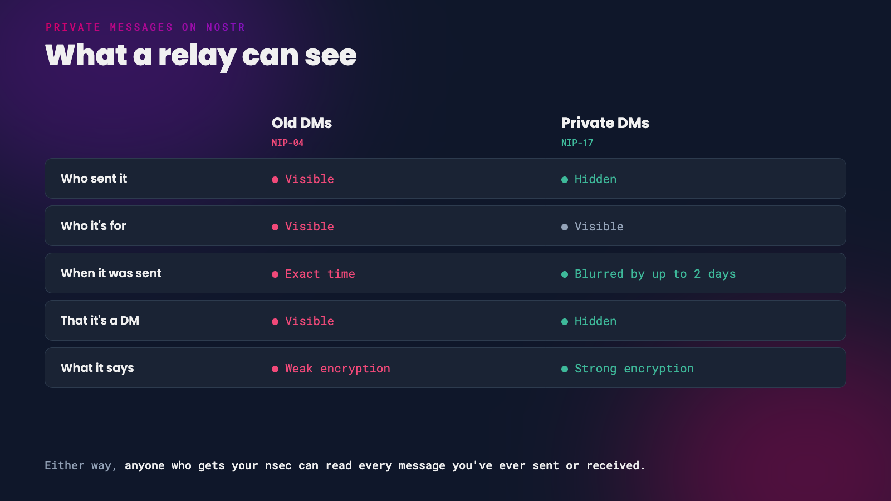

Most Nostr clients have a messages tab where you can chat privately with anyone, with no phone number or email needed. The content of those messages is always encrypted, but how private a DM really is depends on which of two standards your app uses. One of them leaks a lot more than most people realise.

This guide explains the difference, shows you which apps use which, and covers the settings that make your messages as private as Nostr allows.

*Old DMs and private DMs, from a relay's point of view*

# Old DMs (NIP-04)

The original Nostr DM standard, [NIP-04](https://github.com/nostr-protocol/nips/blob/master/04.md), encrypts the text of your message and then publishes it like any other event. That means anyone watching the relays can see:

- who sent the message
- who it was sent to
- exactly when it was sent
- roughly how long it is

So the whole world can see who you talk to and when, even if they can't read what you said. The encryption itself is also weak by modern standards. In 2025, researchers [showed practical attacks](https://eprint.iacr.org/2025/1459) on NIP-04 messages, including forging messages and, in some apps, recovering what they said.

NIP-04 is now officially marked 'unrecommended' and replaced by NIP-17. Its own spec says it must not be used for anything you need to keep secret.

 

# Private DMs (NIP-17)

[NIP-17](https://github.com/nostr-protocol/nips/blob/master/17.md) fixes most of these problems with a technique called 'gift wrapping'.

*A sealed message inside a gift wrap*

1. Your message is encrypted and **sealed** with your key, so the recipient knows it came from you.
2. The sealed message is then encrypted again and **gift-wrapped** using a brand new, throwaway key made just for that one message.
3. The gift wrap's timestamp is blurred by up to two days.

From the outside, a relay sees a package from a random stranger, with a fuzzy date, addressed to your recipient. It can't tell who sent it, when it was really sent, or even that it's a DM. Only the recipient can unwrap it, check the seal and read the message. Both layers use [NIP-44](https://github.com/nostr-protocol/nips/blob/master/44.md) encryption, which was independently audited in 2023.

NIP-17 also supports small group chats. Each member gets their own gift-wrapped copy of every message.

 

# What Even NIP-17 Doesn't Hide

NIP-17 is a big step up, but it still has limits:

- **The recipient is visible.** The gift wrap has to be addressed to someone, so relays can see who is receiving private messages, even if they can't see who from.
- **Relays see your IP address**, like any website you connect to. Use a VPN or Tor if that matters to you.
- **There's no forward secrecy.** Your nsec can decrypt every message you have ever sent or received. If your key leaks, your whole message history leaks with it.
- **Length is only partly hidden.** Messages are padded, but very long and very short messages can still be told apart.

{: .caution }
Your DMs are only as safe as your nsec. Keep it in a signer, never paste it into apps you don't trust, and read our guides to [Amber](/amber) and [securing your nsec on iPhone and desktop](/nsec-iphone-desktop).

 

# Which Apps Use Which

This is how popular clients behaved at the time of writing. Apps change quickly, so check your app's settings too.

| App | Sends private DMs (NIP-17)? |
|-----|-----------------------------|
| Amethyst | Yes. Old DMs removed completely |
| Damus | Yes. Old DMs are off unless you turn them on in **Settings > Privacy** |
| Coracle | Yes. Old DMs removed |
| 0xchat | Yes |
| YakiHonne | Yes, on by default ('Secure direct messaging') |
| noStrudel | Yes, but replies in old DMs if the other person used them |
| Nostur | Only when both people have DM relays set, or you turn on **Increase privacy** in the conversation |
| Primal | No. Its Android app still sends old DMs |
| Jumble | Uses its own variation that only works with other apps that support it |

{: .note }
If you message someone whose app only supports old DMs, some apps will fall back to NIP-04 to reach them. Amethyst refuses to send at all if the other person hasn't set up private DMs.

 

# Set Up Your DM Relays

With NIP-17, people send your private messages only to the relays you choose for DMs, listed in your profile's DM relay list. If you don't have one, many apps won't be able to send you private messages at all.

- **Amethyst** - go to your **Relays** settings and fill in **DM Inbox Relays**. Amethyst also prompts you to set up your private inbox relays.
- **noStrudel** - set them in the **Messages** settings.

Keep the list short, one to three relays. For the best privacy, choose relays that require you to log in (NIP-42 authentication) before they hand out DMs, so only you can download messages addressed to you. Running [your own relay](/run-your-own-relay), such as HAVEN's chat relay, is the strongest option.

 

# DMs and Signers

If you use a signer like [Amber](/amber) or Clave, your messaging app has to ask it to encrypt and decrypt every message. The first time you open your messages, expect your signer to ask permission to encrypt and decrypt (NIP-44) and to sign gift-wrapped events. Approve these only for apps you trust with your messages.

 

# When You Need More

For sensitive conversations, use a messenger built for privacy first. The NIP-44 spec itself recommends specialised end-to-end encrypted messaging software for high-risk use.

- **[White Noise](https://www.whitenoise.chat/)** brings MLS, an internet standard for secure group messaging, to Nostr. It adds forward secrecy, so a stolen key doesn't unlock old messages. It's still in development, with Android builds available and an iPhone beta.
- **[Signal](https://signal.org/)** and **[SimpleX](https://simplex.chat/)** are mature private messengers.

# Quick Checklist

- Use an app that sends private DMs (NIP-17) by default.
- Set your DM relays, and pick relays that require login.
- Turn off old DMs if your app lets you.
- Keep your nsec in a signer.
- Move anything sensitive to a dedicated private messenger.

---

If you found this post useful, please share it with your peers and consider following and zapping me on Nostr. If you write to me and let me know
that you found me via this post, I'll be sure to Zap you back! ⚡️

  <button
    id="nostr-zap-target"
    class="hero__button button button--primary nostr-zap-button nostr-zap-button--primary"
    data-npub="npub15c88nc8d44gsp4658dnfu5fahswzzu8gaxm5lkuwjud068swdqfspxssvx"
    data-relays="wss://relay.damus.io,wss://relay.snort.social,wss://nostr.wine,wss://relay.nostr.band"
  >
    Zap Me ⚡️
  </button>

  <a
    href="https://primal.net/p/npub15c88nc8d44gsp4658dnfu5fahswzzu8gaxm5lkuwjud068swdqfspxssvx"
    target="_blank"
    rel="noopener noreferrer"
    class="hero__button button button--primary"
  >Follow Me ✅</a>

