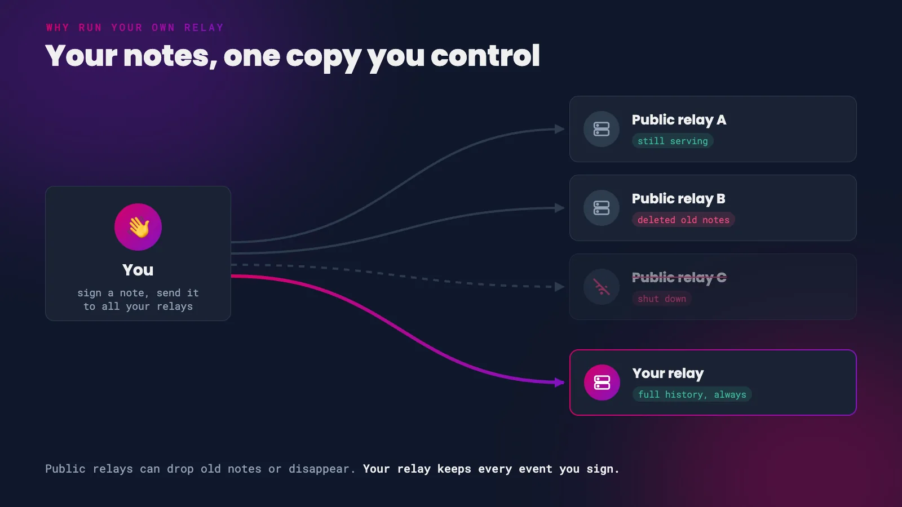
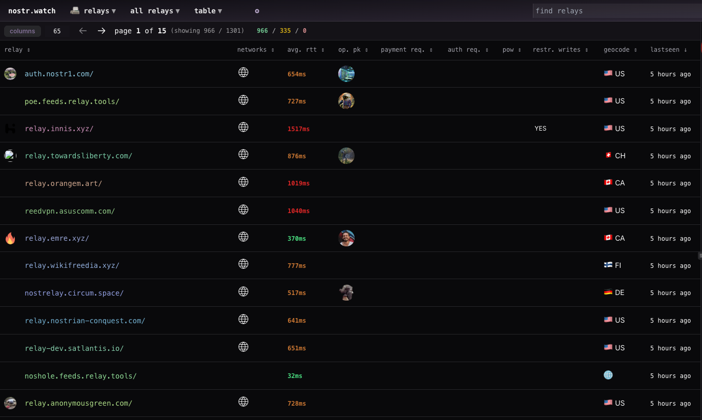

Every note, like, zap and profile update you make on Nostr is stored on relays. If you followed our [first steps](/start) guide, those relays are run by somebody else. Most of them do a great job, but they owe you nothing. A public relay can delete old events to save disk space, block your account, or shut down for good, and your history goes with it.

Running your own relay fixes that. You keep a complete copy of every event you sign, on a server you control, and you can add it to any client alongside the public relays you already use. It's also much easier than it sounds. If you have an Android phone, you can have one running in a couple of minutes.


*Public relays come and go. Your relay keeps everything.*

# Why Run Your Own Relay?

**A backup you control.** Your relay keeps every event you send it, for as long as you want. If a public relay drops your old notes, your copy is still there and can be re-published.

**The outbox model.** Your client publishes a list of the relays you write to ([NIP-65](https://github.com/nostr-protocol/nips/blob/master/65.md), event kind 10002). Other clients read that list to find your notes. If your own relay is on it, people can always find your content, even if every public relay you use disappears.

**A private inbox for DMs.** Private messages on Nostr ([NIP-17](https://github.com/nostr-protocol/nips/blob/master/17.md)) are sent only to the relays you list for DMs (kind 10050). Point that list at your own relay and your encrypted messages land on hardware you control. Relays that support [NIP-42](https://github.com/nostr-protocol/nips/blob/master/42.md) authentication can make sure only you can download them.

**Censorship resistance.** Nobody can stop your own relay from serving your own notes.

> Running a personal relay is a powerful way to improve the redundancy of your Nostr events.
>
> <cite>– QnA</cite>

# Pick Your Path

There is no single 'right' way to run a relay. Pick the option that matches the hardware you have and how hands-on you want to be.

| Option | Runs on | Effort | Cost | Can others reach it? |
|--------|---------|--------|------|----------------------|
| [Citrine](#citrine-a-relay-on-your-phone) | Android phone | Very low | Free | No, backup only |
| [Umbrel or Start9](#umbrel-and-start9) | Home node | Low | Free | With Tailscale or Tor |
| [HAVEN](#haven-four-relays-in-one) | Computer or server | Medium | Free | Yes, with a domain |
| [Hosted relay](#paid-hosted-relays) | Someone else's server | Very low | From a few thousand sats | Yes |
| [Your own server](#your-own-server) | VPS | High | VPS rental | Yes |

{: .tip }
You don't have to pick just one. A phone relay for backup plus a hosted or home relay for your outbox is a great combination.

<br/>

# Citrine: A Relay on Your Phone

[Citrine](https://github.com/greenart7c3/Citrine) is a free and open source Android app that runs a Nostr relay on your phone. It comes from the same developer as [Amber](/amber), and it is the quickest way to start keeping your own copy of your notes.

Because the relay lives on your phone, other people can't connect to it. Its job is backup: every client on your phone sends your events to it as you use Nostr.


*A relay in your pocket*

1. Download Citrine from [Zap Store](https://zapstore.dev/), [F-Droid](https://f-droid.org/packages/com.greenart7c3.citrine/), [Obtainium](https://github.com/ImranR98/Obtainium) or [GitHub](https://github.com/greenart7c3/Citrine/releases).

<div class="button-container">
  <a
    href="https://github.com/greenart7c3/Citrine/releases"
    target="_blank"
    rel="noopener noreferrer"
    class="hero__button button button--primary"
  >Download Citrine ⬇️ </a>
</div>

<br/>

{:start="2"}
2. Open Citrine. The relay starts on your phone at `ws://127.0.0.1:4869`.

{:start="3"}
3. Add `ws://127.0.0.1:4869` to your Nostr client. In [Amethyst](https://github.com/vitorpamplona/amethyst), tap your profile picture, then **Relays**, and add it under **Local Relays**. Other apps are covered [below](#add-your-relay-to-your-client).

{:start="4"}
4. Copy your existing notes into Citrine so the backup starts with your full history. See [Copy Your Old Notes Over](#copy-your-old-notes-over).

Citrine can also export its database, or just your own events, so you can keep an offline copy. If your phone has been offline, it can rebroadcast your events to other relays once you reconnect.

{: .note }
On iPhone? iOS doesn't allow an app like Citrine to keep running in the background. Use one of the other options below.

<br/>

# Umbrel and Start9

If you already run a Bitcoin node at home on [Umbrel](https://umbrel.com/) or [Start9](https://start9.com/), you're one click away from your own relay.

**Umbrel** has an official **Nostr Relay** app in its app store, built on [nostr-rs-relay](https://github.com/scsibug/nostr-rs-relay).

1. Open the Umbrel App Store, search for **Nostr Relay** and install it.
2. Install the **Tailscale** app on your Umbrel and on your phone, and turn on MagicDNS. This lets your devices reach the relay from anywhere without exposing your node to the internet.
3. Add `ws://umbrel:4848` to your Nostr clients.
4. Open the Nostr Relay app and tap the globe icon to copy your past activity from your public relays into it.



**Start9** offers nostr-rs-relay as an official package in the StartOS marketplace. Install it from the marketplace and add the address StartOS gives you to your clients.

{: .note }
A relay at home behind Tailscale is private to your devices, much like Citrine. Other people can't read from it, so keep at least one public relay in your outbox list too.

<br/>

# HAVEN: Four Relays in One

[HAVEN](https://github.com/barrydeen/haven) (High Availability Vault for Events on Nostr) is a personal relay package built around the outbox model. One install gives you four relays, each with a different job:

- **Outbox** for the notes you publish, readable by anyone
- **Inbox** for replies and mentions from other people
- **Chat** for DMs, protected by authentication
- **Private** for drafts and anything only you should see

It also includes a [Blossom](https://github.com/hzrd149/blossom) media server for your images and videos, web of trust filtering to keep spam out, an **Import Old Notes** feature, and backup and restore to a file or to cloud storage.

HAVEN runs on Linux, macOS or a home node. Download the release for your system, fill in the `.env` file with your npub and relay domain, and start it. The [README](https://github.com/barrydeen/haven#readme) walks through each setting, and community installers exist for Docker, Umbrel and StartOS.

{: .tip }
HAVEN's developer describes it as feature complete. Expect bug fixes from here, not big new features.

<br/>

# Paid Hosted Relays

Don't want to run anything yourself? A paid relay gets you a reliable outbox with zero maintenance, and paying keeps out most of the spam found on free relays.

- **[nostr.wine](https://nostr.wine/)** - a one-time payment of 18,888 sats for access, payable over Lightning, on-chain or by card.
- **[relay.tools](https://relay.tools/)** - your own named relay from 5,000 sats a month, with a 14-day free trial. It can pull in notes from the people you follow and back up your history.

A hosted relay isn't 'yours' in the same way as one on your own hardware, but as a paying customer you're far less likely to be dropped, and you can always run your own alongside it.

<br/>

# Your Own Server

For full control, rent a small VPS and run relay software on it yourself. This is the most work, but you end up with a public `wss://` relay on your own domain. The two most popular choices are:

- **[strfry](https://github.com/hoytech/strfry)** - fast, widely used, and syncs with other relays using negentropy. Configured in `strfry.conf`.
- **[nostr-rs-relay](https://github.com/scsibug/nostr-rs-relay)** - simple to set up with Docker. Configured in `config.toml`.

The quickest route is nostr-rs-relay in Docker:

1. Point a domain such as `relay.yourdomain.com` at your VPS.
2. Create a `config.toml` that sets your relay address and only accepts events from your own key. Use your public key in hex format, which you can get from your npub with `nak decode npub1...`.

```toml
[info]
relay_url = "wss://relay.yourdomain.com/"
name = "My relay"

[authorization]
pubkey_whitelist = ["your-hex-public-key"]
```

{:start="3"}
3. Run the relay with Docker, following the **Quick Start** in the [nostr-rs-relay README](https://github.com/scsibug/nostr-rs-relay#quick-start). It listens on port 8080 inside the container, so publish it on the same port with `-p 8080:8080`.
4. Put a reverse proxy in front of it to handle TLS, so clients can connect over `wss://`. [Caddy](https://caddyserver.com/) does this with a three-line config and fetches the certificate for you:

```
relay.yourdomain.com {
    reverse_proxy localhost:8080
}
```

{: .caution }
Always restrict who can write to a personal relay. An open relay on a public address will quickly fill up with other people's spam. With strfry, use a [write policy plugin](https://github.com/hoytech/strfry/blob/master/docs/plugins.md) to do the same job as the whitelist above.

<br/>

# Add Your Relay to Your Client

Once your relay is running, add its address to the clients you use. Add it as a **write** relay so it is included in the relay list your client publishes, and other people's clients can find your notes there.

- **Damus** - open the side menu, tap **Relays**, and add your relay address.
- **Primal** (Android) - go to **Settings > Network** and tap **Add a relay**.
- **Amethyst** - tap your profile picture, then **Relays**. Add your relay under **Outbox**, and under **DM Inbox** if you want your private messages delivered to it.

If a client asks whether a relay should be read, write or both, choose both for your own relay.

<br/>

# Copy Your Old Notes Over

A new relay only stores events from the moment you connect it. To bring your history across:

- **Umbrel** - tap the globe icon in the Nostr Relay app.
- **HAVEN** - use **Import Old Notes**.
- **Amethyst** - the **Relay Sync** tool sends your events to the right relays.
- **relay.tools** - backs up your history for you.

If you run your own server, [nak](https://github.com/fiatjaf/nak) can sync events between two relays using negentropy ([NIP-77](https://github.com/nostr-protocol/nips/blob/master/77.md)), as long as both relays support it:

```
nak sync wss://relay.damus.io wss://relay.yourdomain.com
```

<br/>

# Test Your Relay

[nostr.watch](https://nostr.watch/) monitors over a thousand public relays. Search for your relay's address to see whether it's online, how fast it responds and which NIPs it supports.


*Browsing public relays on nostr.watch*

You can also check from a terminal. Every relay publishes an information document ([NIP-11](https://github.com/nostr-protocol/nips/blob/master/11.md)) describing itself:

```
curl -H "Accept: application/nostr+json" https://relay.yourdomain.com
```

With [nak](https://github.com/fiatjaf/nak) installed, read the latest five notes from your relay, or publish a test note to it:

```
nak req -k 1 -l 5 wss://relay.yourdomain.com
nak event -c 'hello' wss://relay.yourdomain.com
```

If the test note shows up in your client, you're all set. Welcome to owning your own corner of Nostr.

> Clients are how you use Nostr, and relays are where the data lives. You need both to make the magic happen.
>
> <cite>– QnA</cite>
