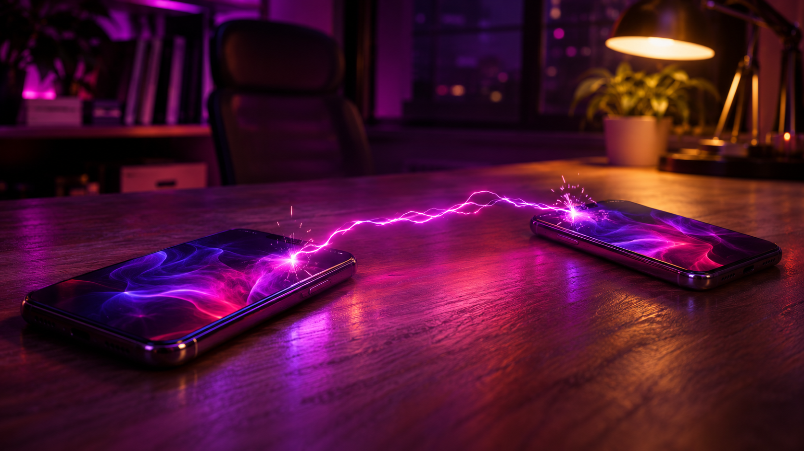
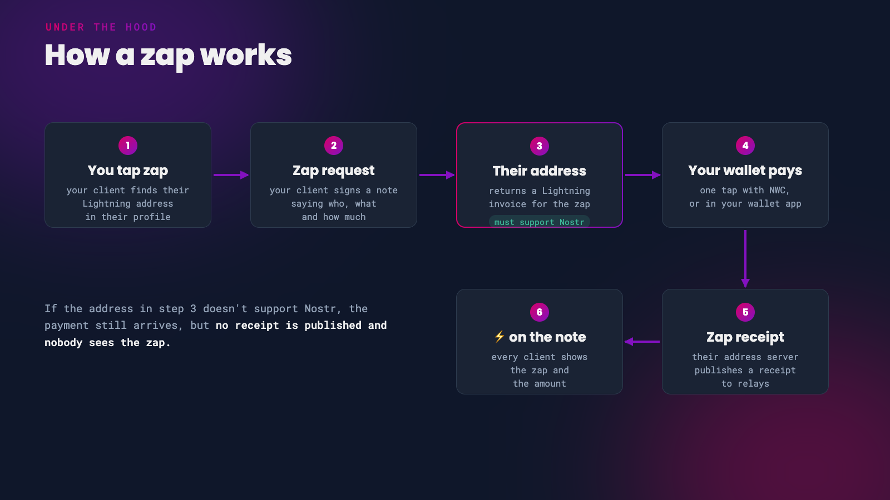

A zap is a Lightning payment attached to a Nostr note or profile. You tap the ⚡ icon, choose an amount, and sats land in the other person's wallet a moment later, with the zap shown publicly on the note for everyone to see. Zaps are how Nostr users tip, thank and support each other, and they're one of the things that makes Nostr feel different from other social networks.

[Your First Steps](/start) got you zapping with a simple wallet. This guide goes further. There are two halves to setting zaps up properly:

1. **Receiving**: a Lightning address on your profile that supports zaps.
2. **Sending**: a wallet connected to your Nostr client with Nostr Wallet Connect, so a zap is a single tap.

*Sats, sent at the speed of a note*

# How a Zap Works

You don't need to know this to zap, but it explains almost every problem people run into.

*The life of a zap ([NIP-57](https://github.com/nostr-protocol/nips/blob/master/57.md))*

When you zap someone, your client looks up the Lightning address in their profile and sends the address's server a signed 'zap request'. The server returns an invoice, your wallet pays it, and the server then publishes a 'zap receipt' to relays. That receipt is what makes the ⚡ and the amount appear on the note.

For receiving, this means **your Lightning address provider has to support Nostr.** If it doesn't, people can still pay you, but no receipt is published and the payment never shows as a zap.

 

# Part 1: Receive Zaps

To receive zaps you need a Lightning address that supports Nostr, added to your profile. A Lightning address looks like an email address, such as `you@getalby.com`, and anyone can pay it from any Lightning wallet.

## Choose a Lightning Address

These providers all give you an address that supports zaps. The big difference between them is who holds the sats.

| Provider | Your address | Who holds the sats |
|----------|--------------|--------------------|
| [Primal](https://primal.net/) | name@primal.net | Primal's built-in wallet, which Primal describes as self-custodial |
| [Alby Hub](https://albyhub.com/) | name@getalby.com | You, on your own Lightning node |
| [Zeus](https://zeusln.com/) | name@zeuspay.com | You, when connected to your own node |
| [Coinos](https://coinos.io/) | name@coinos.io | Coinos (custodial) |
| [Wallet of Satoshi](https://www.walletofsatoshi.com/) | name@walletofsatoshi.com | Wallet of Satoshi (custodial, not available in the US) |
| [Minibits](https://www.minibits.cash/) or [npub.cash](https://npub.cash/) | name@minibits.cash or your npub@npub.cash | The Cashu mint you use |
| [Rizful](https://rizful.com/) | name@rizful.com | Rizful (custodial) |

{: .tip }
**The easiest start:** sign up for [Primal](https://primal.net/) and its wallet gives you a name@primal.net address that already works for zaps. Back up the wallet in Primal's wallet settings straight away.

**The most self-custodial option** is [Alby Hub](https://albyhub.com/), a Lightning node you run yourself or have hosted. Link it to an Alby Account and you get a name@getalby.com address that pays straight into your node. It has to be online to receive, and you'll need to open a Lightning channel, so it suits people who are comfortable with a little more setup.

{: .caution }
With a custodial wallet, the company holds your sats. Keep only small amounts there and move anything larger to a wallet you control.

{: .note }
Phoenix doesn't offer a standard Lightning address, so it can't receive zaps at the moment. You can still pay zap invoices from it by hand.

 

## Add It to Your Profile

1. Open your Nostr client and go to **Edit Profile**.
2. Paste your address into the **Lightning address** field.
3. Save your profile.

Your profile is shared across Nostr, so you only need to do this once. Every client will pick up the new address.

**Check your address supports zaps.** Open `https://domain/.well-known/lnurlp/name` in a browser, replacing `name@domain` with your address. For example, `you@getalby.com` becomes `https://getalby.com/.well-known/lnurlp/you`. If the page includes `"allowsNostr": true`, you're good to go.

 

# Part 2: Send Zaps With Nostr Wallet Connect

[Nostr Wallet Connect](https://github.com/nostr-protocol/nips/blob/master/47.md) (NWC) links a Lightning wallet to your Nostr client. Once connected, your client can pay zaps for you without opening your wallet app, so a zap really is one tap.

The connection is a long code starting with `nostr+walletconnect://` that your wallet creates and your client stores. Most wallets let you give each connection a **budget**, such as 10,000 sats a week, so a client can never spend more than you've allowed.

{: .caution }
Treat your NWC code like a password. Anyone who has it can spend from your wallet, up to the connection's budget. Set a budget on every connection.

 

## Wallets That Offer NWC

[Alby Hub](https://albyhub.com/), [Zeus](https://zeusln.com/), [Primal](https://primal.net/), [Coinos](https://coinos.io/), [Minibits](https://www.minibits.cash/), [Cashu.me](https://cashu.me/), [Rizful](https://rizful.com/), LNbits, Blitz and Flash all create NWC connections. The [awesome-nwc](https://github.com/getAlby/awesome-nwc) list keeps track of the rest.

## Connect Alby Hub to Your Client

1. In Alby Hub, open the **App Store** and choose your Nostr client, such as Damus or Amethyst.
2. Click **Connect**, then set a budget and how often it renews.
3. Alby Hub shows a connection code and QR code. Paste the code into your client, or scan the QR code with it.
4. Send a small test zap.

You can check how much of a budget has been used, or change it, under **Connections** in Alby Hub at any time.

## In Popular Clients

- **Damus**: has a built-in Wallet screen. Paste or scan any NWC code there, or use its one-tap Coinos setup, and set a maximum budget. If you connected Coinos before September 2026, remove the connection and set it up again.
- **Primal**: the built-in wallet handles zaps with no setup. On the web app, you can connect an outside wallet under **Settings > Connected Wallets**.
- **Amethyst**: long-press the ⚡ icon on any note to open the zap settings, then paste your NWC code into the Nostr Wallet Connect section. Amethyst also has its own built-in Cashu wallet.

{: .note }
Using Zeus on your phone as the NWC wallet? Zeus has to be running to pay zaps. On Android, turn on its Persistent Mode. On iPhone, don't force-quit Zeus.

 

# Nutzaps

Some clients, including Amethyst, also support 'nutzaps' ([NIP-61](https://github.com/nostr-protocol/nips/blob/master/61.md)). A nutzap sends Cashu ecash instead of a Lightning payment. The recipient claims it later, so their wallet doesn't need to be online when you zap. The trade-off is that you both have to trust the Cashu mints involved.

 

# Troubleshooting

**My zap was paid, but doesn't show on the note.** The recipient's Lightning address doesn't support Nostr, so no zap receipt was published. Use the check in [Add It to Your Profile](#add-it-to-your-profile) on their address.

**I added an address but people can't zap me.** Make sure it's in the Lightning address field, in the `name@domain` format. An old-style `LNURL1...` code doesn't belong there.

**One-tap zaps stopped working.** Work through these in order:

- Your wallet is offline. Self-custodial wallets like Alby Hub and Zeus have to be running.
- The connection's budget has run out. Raise it or wait for it to renew.
- Your wallet changed or revoked the connection. Delete it in your client and connect again.
- The connection's relay is down. Damus shows the relay's status on its Wallet screen.

---

If you found this post useful, please share it with your peers and consider following and zapping me on Nostr. If you write to me and let me know
that you found me via this post, I'll be sure to Zap you back! ⚡️

  <button
    id="nostr-zap-target"
    class="hero__button button button--primary nostr-zap-button nostr-zap-button--primary"
    data-npub="npub15c88nc8d44gsp4658dnfu5fahswzzu8gaxm5lkuwjud068swdqfspxssvx"
    data-relays="wss://relay.damus.io,wss://nos.lol,wss://relay.primal.net,wss://nostr.wine"
  >
    Zap Me ⚡️
  </button>

  <a
    href="https://primal.net/p/npub15c88nc8d44gsp4658dnfu5fahswzzu8gaxm5lkuwjud068swdqfspxssvx"
    target="_blank"
    rel="noopener noreferrer"
    class="hero__button button button--primary"
  >Follow Me ✅</a>

